# PENJELASAN — Dari Awal Sampai Akhir

**Catatan belajar pribadi: memahami proyek ini dari awal sampai akhir sebelum bimbingan.**
Saat bimbingan, yang ditunjukkan ke dosen adalah [`ringkasan_eksperimen.xlsx`](ringkasan_eksperimen.xlsx)
(lembar `Jawaban`), dan yang diucapkan mengikuti [`NASKAH_BIMBINGAN.md`](NASKAH_BIMBINGAN.md).

Proyek: peramalan harga jual emas Antam · 21 model · 210 eksperimen
Versi dokumen: **1.0.2** (hasil dibekukan pada 1.0.0) · Protokol `v9-21model-dpformer-bao-aligned-honest-mossa-shap-leakage-safe-embargo`
Sidik jari data: `7aea8db80d44` · Python 3.13.0

> **Rujukan teknis:** [`../README.md`](../README.md)

---

## Cara memakai dokumen ini

| Kalau waktu… | Baca |
|---|---|
| **5 menit** | Bagian **Penutup** — satu paragraf kesimpulan, tiga kontribusi, dan tujuh batasan yang harus disebut lebih dulu |
| **30 menit** | **Pembuka** → **Notebook 04** → **10** → **17** → **Penutup** (masalah, desain, uji statistik, daya uji, kesimpulan) |
| **2 jam / mendalam** | Seluruh dokumen urut (urutannya sama dengan notebook 00 → 19), ditambah Lampiran **C** (FAQ pertanyaan dosen) |
| **Butuh angka cepat** | [`ringkasan_eksperimen.xlsx`](ringkasan_eksperimen.xlsx) — buka lembar `Jawaban` (hasil singkat, tabel per horizon, dan tanya-jawab untuk "gimana hasilnya?"); lembar lain memuat tabel dan grafik per topik, semuanya dihitung dari CSV hasil |
| **Mau latihan bicara** | [`NASKAH_BIMBINGAN.md`](NASKAH_BIMBINGAN.md) — naskah lisan untuk bimbingan: alur ±3–4 menit, 13 jawaban singkat untuk pertanyaan yang mungkin muncul, dan kalimat yang sebaiknya dihindari |

> **Urutan dokumen = urutan notebook (00 → 19).** Setiap bagian membahas satu notebook; bagian **Pembuka** (latar belakang) membukanya dan **Penutup** (kesimpulan, kontribusi, batasan) menutupnya. Bagian bertanda 🆕 (Notebook 12 dan 18) disusun dari narasi dan output notebook karena versi sebelumnya belum membahasnya. Nomor bab lama (01–12) dipetakan ke urutan ini di Lampiran E.

Setiap bagian (satu notebook) memakai kerangka seragam:

- **❓ Pertanyaan yang dijawab** — inti bagian dalam satu kalimat
- **💡 Penjelasan** — kenapa langkah ini diambil, apa alternatifnya, kenapa alternatifnya ditolak
- **📁 Bukti di repo** — file, tabel, dan figur yang bisa langsung ditunjukkan

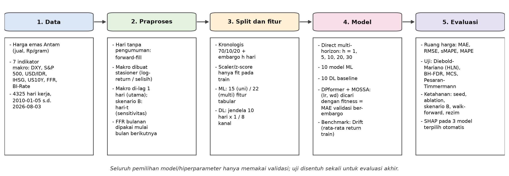

*Versi lebar yang lebih terbaca — dengan pembeda tiga jenis langkah: **A** = mengikuti
Bao et al. (2026), **B** = adaptasi, **C** = kontribusi penelitian ini — ada di
[`../diagram/alur_penelitian_lebar.png`](../diagram/alur_penelitian_lebar.png)
(sumber teks: `../diagram/alur_penelitian_mermaid.txt`).*

---

## Daftar isi

| Bagian | Judul |
|---|---|
| Pembuka | Latar belakang dan pertanyaan penelitian |
| Notebook 00 | Unduh indikator makro |
| Notebook 01 | Pembersihan data |
| Notebook 02 | Penggabungan data |
| Notebook 03 | EDA dan stasioneritas |
| Notebook 04 | Desain eksperimen: target, fitur, pembagian data, rezim pasar |
| Notebook 05 | DPformer + MOSSA (dan gambaran 21 model) |
| Notebook 06 | Deep learning — 10 baseline |
| Notebook 07 | Machine learning — 10 model dan benchmark Drift |
| Notebook 08 | Tujuh pagar integritas |
| Notebook 09 | Hasil dasar dan peringkat |
| Notebook 10 | Uji statistik (DM, BH-FDR, MCS, arah) |
| Notebook 11 | Interpretasi (SHAP) |
| Notebook 12 | 🆕 Analisis tambahan pasca-evaluasi |
| Notebook 13 | Ketahanan: seed acak |
| Notebook 14 | Ablation: kelompok fitur dan tuning MOSSA |
| Notebook 15 | Skenario B: informasi penutupan hari-t |
| Notebook 16 | Walk-forward |
| Notebook 17 | Selang kepercayaan dan daya uji (MDE) |
| Notebook 18 | 🆕 Kombinasi bobot-sama dan Drift adaptif |
| Notebook 19 | Tangga waktu informasi dan plasebo |
| Penutup | Kesimpulan, kontribusi, dan batasan |
| A | Peta file repo |
| B | Glosarium |
| C | FAQ — kemungkinan pertanyaan dosen |
| D | Cara menjalankan ulang |
| E | Peta bab lama → bagian baru |

---

# Pembuka — Latar belakang dan pertanyaan penelitian

### ❓ Pertanyaan yang dijawab

*Apa sebenarnya yang diprediksi, dan mengapa itu bukan sekadar "menebak harga emas"?*

### 💡 Penjelasan

Emas dalam Rupiah punya dua pembentuk harga: harga emas dalam dolar dunia, dan nilai
tukar USD/IDR. Keduanya digerakkan oleh faktor yang sama-sama bisa diamati — kebijakan
suku bunga AS, imbal hasil obligasi, sentimen pasar global. Jadi secara intuisi,
**mungkin** harga emas Antam bisa ditebak dari data makro lampau.

Pertanyaan penelitiannya bukan "apakah bisa ditebak", melainkan **seberapa yakin kita
bisa mengklaim demikian**. Dua hal membuat pertanyaan itu lebih sulit dari kelihatannya:

1. **Harga Antam adalah harga postingan administratif.** Bukan harga transaksi yang
   bergerak setiap detik. Harganya tetap sampai ada pengumuman baru — 22,47% hari pada
   periode latih tidak bergerak sama sekali (return nol). Deret ini punya mikrostruktur
   yang berbeda dari deret harga pasar biasa.
2. **Menguji banyak model menimbulkan masalah sendiri.** Kalau 21 model diuji, beberapa
   akan "menang" secara kebetulan. Tanpa koreksi uji berganda (BH-FDR) dan tanpa benchmark
   yang jujur, kita akan menemukan sesuatu yang tidak ada.

Empat pertanyaan yang kemudian dijawab berurutan:

| # | Pertanyaan | Dijawab di |
|---|---|---|
| 1 | Bisa diprediksi tidak, dan seberapa yakin? | Notebook 10 dan 17 |
| 2 | Apakah fitur makro membantu dibanding harga sendiri saja? | Notebook 10 (juga 14) |
| 3 | Apakah hasilnya bergantung pada keberuntungan seed / model / periode? | Notebook 13, 14, 16 (dan 15, 19 untuk waktu informasi) |
| 4 | Kalau negatif semua, apa kontribusinya? | Penutup |

### 📁 Bukti di repo

```
src/config.py                              PROTOCOL, ML_REV, HORIZONS, SETUPS
notebooks/03_eda_dan_stasioneritas.ipynb   pengantar konsep & statistik deskriptif
outputs/results/statistik_deskriptif.csv
```

---

# Notebook 00 — Unduh indikator makro

### ❓ Pertanyaan yang dijawab

*Data apa yang masuk dan dari mana asalnya — mana yang diunduh otomatis, mana yang manual?*

### 💡 Penjelasan

Notebook ini mengunduh indikator ekonomi makro lewat API publik. **Hanya harga emas Antam dan BI-Rate yang manual** (berkasnya sudah ada di `data/raw/`).

| Sumber | Isi | Cara |
|---|---|---|
| Berkas manual | harga emas Antam; BI-Rate (unduhan BIS) | sudah ada di `data/raw/` |
| Yahoo Finance | DXY (`DX-Y.NYB`) · S&P 500 (`^GSPC`) · USD/IDR (`USDIDR=X`) · IHSG (`^JKSE`) | API |
| FRED | US 10Y (`DGS10`) · FFR (`FEDFUNDS`) · `id_tbill` (`INTDSRIDM193N`; **tidak dipakai**, hanya kelengkapan) | API |

**Fallback.** Bila API sedang tidak bisa diakses, notebook otomatis memakai salinan cache di `data/raw/_fallback_cache/` (data historis dari eksperimen sebelumnya, sampai Agustus 2026), sehingga Notebook 01 dan seterusnya tetap bisa dijalankan.

> **Yang sengaja tidak dipakai:** harga emas dunia (XAU/USD), LBMA, COMEX. Ini batasan
> yang harus diakui lebih dulu — lihat Penutup dan Lampiran C.

### 📁 Bukti di repo

```
data/raw/                        Antam + 8 berkas makro (7 terpakai; id_tbill tidak dipakai) + cache fallback API
notebooks/00_unduh_indikator_makro.ipynb
```

---

# Notebook 01 — Pembersihan data

### ❓ Pertanyaan yang dijawab

*Bagaimana mengisi hari kerja tanpa pengumuman harga (termasuk hari libur nasional) tanpa diam-diam menyuntikkan informasi masa depan?*

### 💡 Penjelasan

**Langkah pembersihan (urutan di notebook).** Notebook ini membersihkan 8 sumber data mentah menjadi deret harian, masing-masing disimpan sebagai berkas `*_bersih.csv` di `data/processed/`:

1. **Harga emas Antam** — ambil pengumuman **terakhir** pada tiap hari kalender (bisa ada lebih dari satu pengumuman per hari), susun ulang ke kalender hari kerja Senin–Jumat, lalu isi hari kerja tanpa pengumuman dengan *forward-fill* (alasannya di bawah).
2. **BI-Rate** — berkas unduhan BIS punya beberapa baris metadata sebelum data dan dua kolom nilai (harian dan bulanan); yang dipakai kolom **harian**, supaya tanggal persis perubahan suku bunga ikut tertangkap.
3. **Indikator makro lain** — standardisasi nama indeks, buang duplikat tanggal dan baris kosong, lalu buang **titik data rusak (*glitch*)** pada empat deret harga/indeks (ambang rasio terhadap median 7 hari: **1,08** untuk USD/IDR dan DXY — ketat, dengan aturan lonjakan-balik — dan **2,0** untuk S&P 500 dan IHSG).

Ketika harga tidak diumumkan, nilainya harus diisi. Ada dua cara:

| Cara | Cara kerja | Masalah |
|---|---|---|
| **Interpolasi** | rata-rata harga sebelum dan sesudahnya | ❌ Memakai harga **berikutnya** = *lookahead* |
| **Forward-fill** | bawa terus harga hari sebelumnya | ✅ Hanya memakai masa lalu |

Forward-fill dipilih karena konsisten dengan kenyataan operasional: kalau Antam tidak
mengumumkan hari itu, yang berlaku tetap pengumuman terakhir. Ini terjadi pada **198 dari
4.326 hari kerja** (4,6%) di berkas mentah. Konsekuensinya, sebagian hari return-nol di
Notebook 03 berasal dari pengisian ini (±25% di periode latih), bukan dari pengumuman yang
harganya sama (±75%) — dan angka itu sendiri justru menjadi temuan (lihat Notebook 03).

**Kenapa hal-hal kecil ini dipisah jadi notebook sendiri?** Karena *lookahead* tidak
menyebabkan error — ia menyebabkan **hasil yang terlalu bagus**. Tidak ada yang memberi
peringatan. Satu-satunya cara menangkapnya adalah pagar di Notebook 08.

### 📁 Bukti di repo

```
notebooks/01_pembersihan_data.ipynb     bersihkan 8 deret, forward-fill
data/processed/*_bersih.csv            8 deret bersih (satu berkas per sumber)
panduan_bimbingan/skrip/audit_data_mentah.py   hitungan 198 hari tanpa pengumuman dan komposisi return nol
                                               (audit berkas mentah; belum ada notebook yang menghasilkannya)
```

---

# Notebook 02 — Penggabungan data

### ❓ Pertanyaan yang dijawab

*Seperti apa tabel master yang dihasilkan, dan mengapa variabel makro harus di-lag sejak tahap penggabungan?*

### 💡 Penjelasan

Notebook ini membaca 8 berkas bersih dan menggabungkannya menjadi satu tabel harian, `data/processed/data_gabungan.csv`. Urutan langkahnya:

1. **Susun ulang** semua indikator ke kalender hari kerja harga emas (gabung berdasarkan tanggal). `bi_rate` (jarang berubah) diisi *forward-fill*; `ffr` dipetakan **as-of** (dijelaskan di bawah); sisa NaN akibat selisih hari libur antar negara diisi *forward-fill* lalu *backward-fill*.
2. **Geser seluruh kolom eksogen (7 indikator) 1 hari kerja** — nilai indikator hari *t−1* dipakai untuk memprediksi hari *t* (alasannya di bawah).
3. **Target** `emas_ret` (return harian harga emas, %) dihitung **sebelum** kolom lain di-lag.
4. **Fitur eksogen stasioner**: selain level mentah, dibuat 7 fitur `*_ret` (log-return: DXY, S&P 500, USD/IDR, IHSG) dan `*_diff` (selisih harian: US 10Y, FFR, BI-Rate) lewat `make_exo_features` di `src/pipeline.py` (satu-satunya definisinya), lalu digeser dengan cara yang sama. **Model hanya memakai fitur stasioner ini**; level mentah disimpan untuk EDA dan uji ADF. Karena `diff(shift(x)) == shift(diff(x))`, tidak ada *lookahead*.

Alasan memilih fitur stasioner — level S&P 500, IHSG, dan FFR di periode uji hampir selalu di luar rentang latih — diukur di Notebook 03.

**Deret utama:** harga jual emas Antam per gram, 4.325 hari kerja dari 2010-01-05 sampai
2026-08-03, 16 variabel (tabel master 4.325 × 17 kolom termasuk tanggal), tanpa *missing*
dan tanpa duplikat. Kalender berisi **seluruh hari kerja Senin–Jumat** (865 hari untuk tiap
hari dalam pekan), sehingga selisih tanggal antar-baris hanya **1 hari** (3.459 kali) atau
**3 hari** (865 kali; Jumat → Senin) — hari libur nasional tidak menghasilkan celah, karena
hari kerja tanpa pengumuman harga Antam (**198** dari 4.326 hari kerja di berkas mentah,
4,6%) diisi *forward-fill* (Notebook 01).

**Tujuh variabel makro** — bukan level, melainkan **transformasi stasioner**:

| Kelompok | Variabel | Transformasi | Kenapa |
|---|---|---|---|
| Log-return | DXY · S&P 500 · USD/IDR · IHSG | `log(x_t / x_{t-1})` | levelnya *trending* dan keluar dari rentang latih |
| Selisih poin | US 10Y · FFR · BI-Rate | `x_t − x_{t-1}` (poin %) | tingkat suku bunga naik/turun, bukan bergerak bebas |

Untuk FFR yang hanya dirilis bulanan, dipakai nilai **as-of**: pengumuman bulan M hanya
mulai dipakai pada bulan berikutnya. Memakainya pada bulan yang sama berarti membaca
keputusan sebelum diumumkan.

**Kenapa di-lag sejak tahap penggabungan, bukan saat pemodelan?** Ramalan pada origin `i`
dibuat setelah harga Antam hari `i` diumumkan (pagi hari). Pada saat itu penutupan pasar
hari `i` — IHSG sore hari, pasar AS dini hari berikutnya — belum ada, jadi kalau nilai
hari `i` dipakai apa adanya, model akan membaca masa depan. Karena itu seluruh fitur
makro digeser 1 hari kerja: baris `i` memuat penutupan hari `i−1`. Konvensi ini
**konservatif** (tidak memakai penutupan hari `i` sama sekali), dan Skenario B (Notebook 15)
menguji apa yang berubah bila penutupan hari `i` sudah diketahui. Menunda lag ke tahap
fitur rawan terlupa; menaruhnya di tahap penggabungan membuat seluruh eksperimen
otomatis aman.

### 📁 Bukti di repo

```
data/processed/data_gabungan.csv tabel master: 4.325 × 17 (tanggal + 16 variabel), fp 7aea8db80d44
src/pipeline.py                  EXO_LEVEL_COLS, EXO_LOGRET_COLS, EXO_DIFF_COLS, EXO_CLIP=5.0
notebooks/02_penggabungan_data.ipynb    gabung + lag-1 + transformasi stasioner
```

---

# Notebook 03 — EDA dan stasioneritas

### ❓ Pertanyaan yang dijawab

*Apakah deret ini bisa dipakai langsung, dan informasi apa yang sebenarnya menggerakkannya?*

### 💡 Penjelasan

Notebook ini hanya membaca `data/processed/data_gabungan.csv` (tidak bergantung pada hasil model). Urutannya: statistik deskriptif → uji ADF → level vs transformasi stasioner → distribusi return dan korelasi → waktu informasi (lead–lag) → porsi hari dengan return nol. Statistik deskriptif seluruh variabel disimpan di `statistik_deskriptif.csv`.

**Stasioneritas (Augmented Dickey–Fuller).** H0: deret memiliki *unit root*. Hasilnya
jelas dan menjadi dasar seluruh transformasi:

| Deret | ADF | p-value | Kesimpulan |
|---|---:|---:|---|
| Harga (level) | 1,4424 | 0,9973 | **Tidak** stasioner — gagal tolak H0 |
| Return harian | −22,7899 | ≈ 0 | Stasioner |
| Harga (diff-1) | −8,2807 | ≈ 0 | Stasioner |

Karena itu targetnya **return**, bukan level, dan fiturnya pun versi stasioner.

**Level vs transformasi stasioner.** Pembacaan level-vs-stasioner juga penting: pada periode uji, **87,3%** baris level
S&P 500 (rentang seluruh data 1.022–7.609, ×7) dan **100%** baris level FFR (0,05–5,33%,
×100) berada di luar rentang periode latih; setelah transformasi stasioner hanya 0,1% dan
0% (`eksogen_level_vs_stasioner.csv`). Model yang dilatih pada level akan banyak
mengekstrapolasi.

**Distribusi dan korelasi.** Figur distribusi return dan peta korelasi return emas dengan fitur eksogen ada di bagian bukti di bawah. **Hati-hati membaca korelasi itu:** kolom eksogen sudah di-lag 1 hari, sehingga korelasi `emas_ret(t)` dengan fitur ber-lag-1 bersifat **kontemporer** — harga Antam hari *t* diumumkan pagi hari, sesudah pasar AS hari *t−1* tutup, jadi sudah memuat informasi itu — **bukan** daya prediksi untuk hari *t+1*. Bagian lead–lag di bawah memisahkan keduanya secara eksplisit.

**Waktu informasi (lead–lag).** Dihitung korelasi return emas hari *t* dengan penutupan
setiap variabel makro pada hari *t−2*, *t−1*, dan *t* (`leadlag_waktu_informasi.csv`).
Hanya **3 dari 7** variabel (DXY, USD/IDR, US 10Y) yang korelasi mutlaknya terbesar pada
*t−1* — DXY −0,288 dan US 10Y −0,233, dibanding −0,062 dan −0,017 pada *t*; keempat
variabel lain (S&P 500, IHSG, FFR, BI-Rate) puncaknya di *t−2*, dengan |r| ≤ 0,084.

Cara membacanya untuk desain: protokol utama meramal return *t+1* dari penutupan hari
*t−1* (pada tabel ini sama dengan baris *t−2*: DXY +0,094, US 10Y −0,022 — hampir tanpa
korelasi), sedangkan sinyal terkuat ada pada penutupan hari *t* (baris *t−1*: DXY −0,288,
US 10Y −0,233). Itulah yang diuji Skenario B (Notebook 15). Jadi tabel ini **bukan** konfirmasi
bahwa lag-1 menempatkan sinyal pada tempatnya, melainkan **motivasi** Skenario B — dan
karena skenario itu dirancang setelah melihat korelasi pada seluruh sampel, temuannya
bersifat eksploratif.

Sebagai pelengkap, R² *in-sample* regresi linear return(*t+1*) terhadap 7 fitur makro hanya ≈ **2%** (0,021) bila memakai nilai lag-1 yang dipakai protokol utama, tetapi ≈ **14%** (0,137) bila memakai penutupan hari-*t* (hanya indikasi, bukan evaluasi). Karena itu kesimpulan "makro tidak membantu" pada protokol utama sebagian merupakan **konsekuensi desain lag-1** — itu harus ditulis di bagian batasan dan dibandingkan dengan hasil Skenario B (Notebook 15).

**Harga yang tidak bergerak.** Sebagian hari menghasilkan return tepat nol (22,47% di
periode latih), dan porsinya turun tajam seiring waktu:

| Periode | Porsi return nol | SD harian | Rentang harga |
|---|---:|---:|---|
| Latih (2010–2021) | **22,47%** | 0,69% | 0,39 – 1,06 jt |
| Validasi (2021–2023) | 12,79% | 0,65% | 0,91 – 1,06 jt |
| Uji (2023–2026) | 7,20% | **0,97%** | **1,04 – 3,17 jt** |

*Kolom SD harian dan rentang harga pada tabel itu berasal dari `rezim_periode_split.csv` (dibuat di Notebook 04).*

Puncaknya tahun 2014: **40,6%** hari tidak bergerak. Sebagian besar ini memang sifat
harga postingan: ±75% hari return-nol di periode latih adalah hari **dengan** pengumuman
yang harganya sama dengan sebelumnya. Tetapi ±25% adalah hari kerja **tanpa** pengumuman
yang diisi *forward-fill* (Notebook 01) — bukan cacat data, namun juga bukan semuanya "harga
yang tidak berubah" (audit: `panduan_bimbingan/skrip/audit_data_mentah.py`). Intinya, model
harus belajar meramal **kapan harga bergerak**, bukan hanya seberapa jauh.

Porsi return nol turun dari sekitar seperlima data latih ke sekitar 7% di periode uji: data latih lebih "kasar" (banyak hari basi) daripada data uji. Itu salah satu alasan hasil perlu diuji juga pada sub-periode dan walk-forward (Notebook 12 dan 16), tidak hanya pada satu blok uji.

### 📁 Bukti di repo

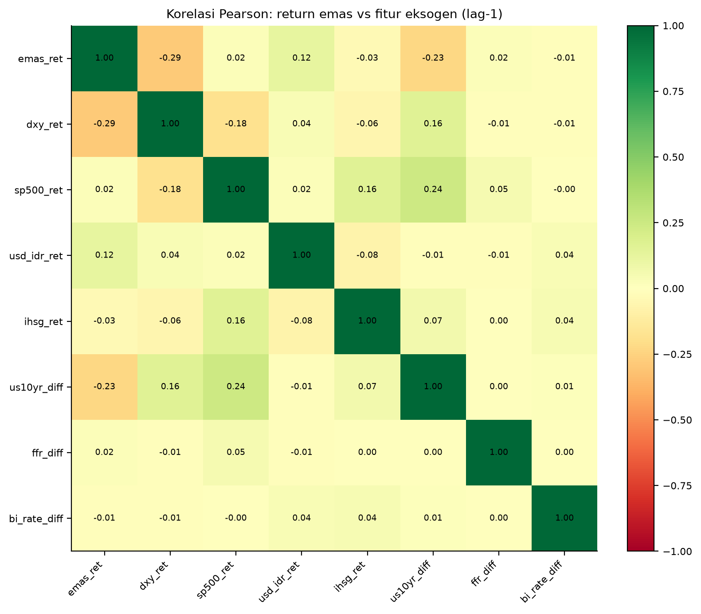

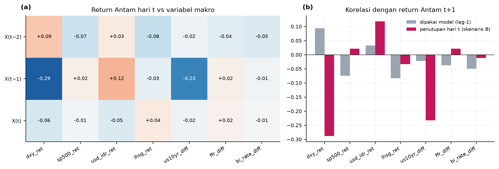

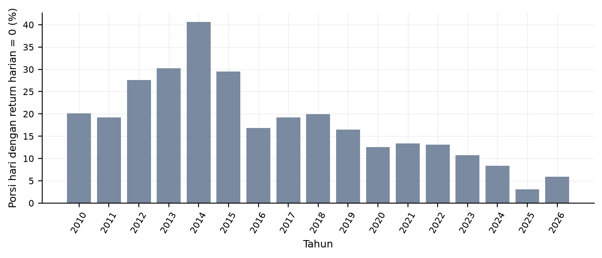

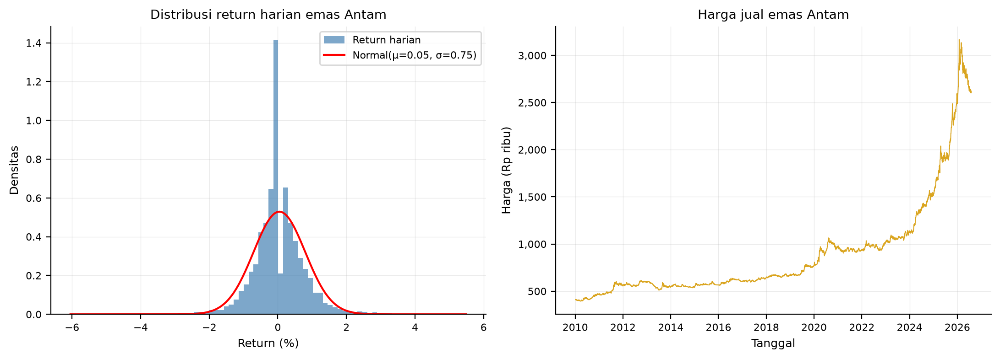

```
outputs/results/statistik_deskriptif.csv
outputs/results/eksogen_level_vs_stasioner.csv   % baris uji di luar rentang latih (level vs stasioner)
outputs/results/adf_hasil.csv                 3 baris: level, return, diff-1
outputs/results/porsi_return_nol_per_tahun.csv 2010–2026
outputs/results/leadlag_waktu_informasi.csv    korelasi pada X(t−2), X(t−1), X(t)
notebooks/03_eda_dan_stasioneritas.ipynb
```

---

# Notebook 04 — Desain eksperimen: target, fitur, pembagian data, dan rezim pasar

### ❓ Pertanyaan yang dijawab

*Apa yang diprediksi, dengan fitur apa, dan bagaimana data dibagi agar tidak bocor?*

### 💡 Penjelasan

Notebook ini menjelaskan dua jalur pembentukan fitur yang dipakai notebook eksperimen (05, 06, 07) — fitur tabular untuk 10 model ML dan jendela deret waktu untuk 11 model DL — serta **mengapa split 70/10/20 kronologis dipertahankan** dan seperti apa tiga periodenya. Fungsi yang dipakai (`build_lgb_features`, `multihorizon_split`) diimpor dari `src/pipeline.py`, modul yang sama persis dengan yang dipakai Notebook 05–07.

**Target — prediksi langsung (*direct multi-horizon*), bukan rekursif.**

```
R_h(i) = p(i+h) / p(i) − 1        ← return kumulatif h hari, diprediksi langsung
p̂(i+h) = p(i) · (1 + r̂)           ← evaluasi dilakukan di ruang LEVEL HARGA
```

*Rekursif* (memprediksi 1 hari, lalu hasilnya dipakai lagi) menumpuk galat di horizon
panjang. *Direct* melatih model khusus untuk setiap horizon. Metrik titik (MAE, RMSE,
MAPE) dihitung di ruang harga, karena yang ditanyakan pengguna adalah "berapa rupiah",
dan satu persen galat di harga mahal berbeda maknanya di harga murah. Uji
Diebold–Mariano (Notebook 10) memakai galat kuadrat **return** (`rel_mse_ret`); versi di ruang
harga (`rel_mse_price`) ada di berkas yang sama sebagai pembanding.

**Dua setup fitur, jumlahnya berbeda:**

| Setup | Isi | Jumlah |
|---|---|---:|
| **Univariat** | `lag_0` (return hari-i) + 8 lag (1, 2, 3, 5, 7, 14, 21, 30) + `roll_mean` dan `roll_std` (jendela 7, 14, 30) | **15** |
| **Multivariat** | di atas + 7 fitur eksogen stasioner | **22** |

`lag_0` ikut serta karena pada origin `i`, return hari `i` **sudah diketahui** — jendela
rolling juga berakhir di hari-`i`, bukan `i−1`. Ini disamakan dengan jendela DL.

**Pembagian data kronologis + embargo.**

Pembagian **kronologis murni** (tanpa pengacakan): 70% latih / 10% validasi / 20% uji dari `n − h` posisi yang punya target; batasnya sedikit bergeser antar horizon.

| h | Latih | Validasi | Validasi (embargo) | Uji | Uji mulai |
|---:|---:|---:|---:|---:|---|
| 1 | 3028 | 432 | 431 | 864 | 2023-04-11 |
| 5 | 3024 | 432 | 427 | 864 | 2023-04-05 |
| 10 | 3021 | 431 | 421 | 863 | 2023-03-30 |
| 20 | 3014 | 430 | 410 | 861 | 2023-03-20 |
| 30 | 3007 | 429 | 399 | 859 | 2023-03-08 |

**Apa itu embargo dan mengapa perlu?** Bayangkan origin validasi pada hari terakhir
periode validasi, dengan `h = 5`. Targetnya `p(i+5)` — dan `i+5` jatuh **di dalam
periode uji**. Kalau baris itu dipakai untuk *early stopping*, maka saat menentukan
model terbaik kita sudah membaca harga periode uji. Embargo membuang baris-baris itu:

```python
# src/pipeline.py
va_ok = [d for d in va_dates if d in F.index and pos_of[d] + h < te_pos[0]]
assert va_ok and all(pos_of[d] + h < te_pos[0] for d in va_ok), \
    'baris validasi untuk early stopping menyentuh periode test'
```

Pada h=30, **30 dari 429** baris validasi dibuang (429 → 399) — persis sebanyak `h`.
Pembuangannya meningkat seiring horizon, persis seperti yang diharapkan.

**Rezim pasar — tiga periode itu tidak sama.** Ini menjawab pertanyaan *"apakah split 70/10/20 masuk akal untuk data emas seperti ini?"* Angka per periode ada pada tabel di Notebook 03 (sumber: `rezim_periode_split.csv`): periode **latih** (≈2010–2021) memuat harga rendah dan banyak hari basi; **validasi** (≈2021–2023) adalah periode *sideways* yang tenang (volatilitas harian paling rendah dari ketiganya); **uji** (≈2023–2026) adalah reli panjang yang lebih bergejolak (harga naik ≈3×). Akibatnya: (i) *loss* validasi bisa lebih rendah daripada *loss* latih — artefak rezim, bukan tanda kebocoran; (ii) tuning pada validasi (MOSSA, *early stopping*) kurang representatif untuk uji; (iii) satu blok uji hanya menggambarkan satu rezim.

**Regim yang berubah.** Periode uji didominasi satu reli besar yang disusul koreksi (harga
1,04 juta → puncak 3,17 juta pada 2026-01-29, lalu turun 17,6% sampai akhir data;
volatilitas 0,97%/hari vs 0,65% di validasi), dan rata-rata return harian periode uji
≈ 3,7× rata-rata periode latih. Artinya latih dan uji berada di rezim berbeda — ini
**mungkin** salah satu alasan hasil di Notebook 10 sebagian negatif; pengaruhnya pada
perbandingan dengan Drift dibahas di Notebook 17 dan 18 (uji stres pembanding).

**Keputusan split dan alasannya.**

| Opsi | Penilaian |
|---|---|
| **70/10/20 kronologis dengan embargo** (utama) | **Dipertahankan**: sejajar dengan jurnal acuan (Bao et al.), seluruh 21 model dievaluasi pada baris uji yang identik, tanpa kebocoran. |
| *K-fold* / pengacakan | **Tidak valid** untuk deret waktu: target h-hari saling tumpang-tindih sehingga baris latih dan uji berbagi informasi. |
| **Walk-forward (*expanding window*, 6 fold × 260 hari)** | Dijalankan sebagai analisis ketahanan di **Notebook 16**: menguji apakah kesimpulan bergantung pada satu rezim uji. |
| Sub-periode dan rezim volatilitas | Di **Notebook 12**: hasil dipecah per blok waktu uji dan tingkat volatilitas. |

Split ulang (mis. 60/10/30 atau memajukan batas uji) **tidak** dipilih: memilih batas karena hasilnya "lebih bagus" adalah *data snooping*. Cara yang benar adalah melaporkan hasil utama apa adanya lalu menunjukkan ketahanannya (Notebook 12 dan 16).

**Jendela deret waktu.** Untuk model deep learning, inputnya jendela `SEQ_LEN = 10` hari multi-channel, dan
z-score di-*fit* **hanya** pada data latih. Kanal eksogen di-*clip* ke ±5 z-score
(`EXO_CLIP`) agar *outlier* tidak mendominasi. Alasan *clip*: pengaman terhadap lonjakan ekstrem seperti kenaikan FFR 2022 yang belum pernah terjadi di data latih. Pada setup multivariat, kanalnya adalah return emas + 7 fitur makro stasioner.

**Kerangka penelitian (diagram).** Notebook ini juga menggambar alur dari data mentah sampai uji statistik — jumlah model, horizon, dan rentang data dibaca dari `src/config.py` dan data — sebagai padanan Fig. 1 jurnal acuan (diagram di awal dokumen ini). Gambar ini orisinal (digambar dari kode), bukan salinan gambar jurnal.

### 📁 Bukti di repo

```
src/pipeline.py          build_lgb_features (docstring: "Jumlah fitur: 15 / 22")
                          multihorizon_split, baris embargo + assert
outputs/results/tabel_split.csv
outputs/results/rezim_periode_split.csv        latih / validasi / uji
notebooks/04_feature_engineering.ipynb
outputs/figures/fig_harga_rezim.png
outputs/figures/fig_kerangka_penelitian.png   diagram kerangka penelitian (juga di awal dokumen ini)
```

---

# Notebook 05 — DPformer + MOSSA (dan gambaran 21 model)

### ❓ Pertanyaan yang dijawab

*Apa itu DPformer, bagaimana hyperparameter-nya dituning tanpa melihat data uji, dan seperti apa gambaran 21 model secara keseluruhan?*

### 💡 Penjelasan

Tiga notebook berikutnya melatih **21 model × 5 horizon × 2 setup = 210 run**: Notebook 05 untuk DPformer (10 run), Notebook 06 untuk 10 baseline DL (100 run), dan Notebook 07 untuk 10 model ML (100 run).

**10 machine learning:**

| | | | | |
|---|---|---|---|---|
| LightGBM | XGBoost | RandomForest | CatBoost | GBM |
| SVR | ExtraTrees | HistGB | AdaBoost | ElasticNet |

**11 deep learning:** LSTM · GRU · BiLSTM · BiGRU · Transformer · DLinear · NLinear ·
PatchTST · LSTM+Attention · GRU+Attention · **DPformer**

Banyak model dipakai bukan untuk "mencari yang paling banyak menang", melainkan untuk
**uji ketahanan**: kalau kesimpulannya hanya berlaku untuk satu arsitektur, ia lemah.
Kalau kesimpulan yang sama muncul dari 21 arsitektur berbeda, ia kuat.

**DPformer** adalah model yang dituning lebih serius. **MOSSA** (populasi **20**,
maksimum **100** iterasi; fitness = MAE **hanya** dari baris validasi ber-embargo; satu
pencarian per setup pada h=20 dengan 10 epoch per evaluasi, hasilnya dipakai untuk semua
horizon) berhenti dini bila `best_fit` tidak membaik ≥ 0,1% selama 20 iterasi (*patience* 20)
— aktualnya di iterasi **22** (univariat) dan **28** (multivariat). Hasilnya `lr` =
7,2×10⁻⁴ / 9,3×10⁻⁴ dan `weight_decay` = 8,4×10⁻³ / 7,5×10⁻³ (univariat / multivariat):
`lr` dekat default `AdamW` 1e-3 yang dipakai semua baseline DL, tetapi `weight_decay`
≈ **75–84×** defaultnya (1e-4). Implementasinya *single-objective*; jurnal acuan menyebut
MOSSA multi-objektif tanpa pseudocode (lihat sel MOSSA di notebook ini).

Rincian tambahan MOSSA (dari `src/config.py` dan `mossa_dpformer.json`): *producers* 20%, *early warners* 10%, rentang pencarian `lr` ∈ [1e-4, 1e-2] dan `weight_decay` ∈ [0, 1e-2]. Jumlah iterasi yang benar-benar berjalan tercatat di `mossa_dpformer.json`.

**Uji kebocoran fitness (otomatis).** Sebelum tuning, notebook menjalankan uji bahwa fitness MOSSA tidak dapat melihat data uji (jenis *mutation test* yang dibahas di Notebook 08): bila data uji dirusak, MAE validasi harus **identik**, dan sebagai kontrol positif metrik **uji** harus berubah. Kalau gagal, notebook berhenti.

**Apakah tuning hanya untuk DPformer itu tidak adil?** Diukur lewat ablation *MOSSA vs default* di **Notebook 14**; hasilnya dibahas di sana.

**Training akhir.** DPformer dilatih untuk 5 horizon × 2 setup. Bobot model multivariat h=20 disimpan di `outputs/results/models/` agar SHAP (Notebook 11) tidak perlu melatih ulang.

### 📁 Bukti di repo

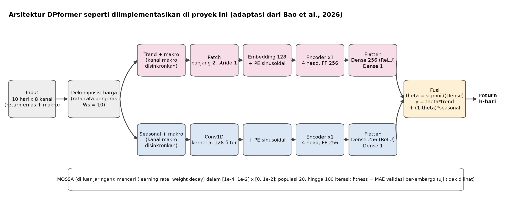

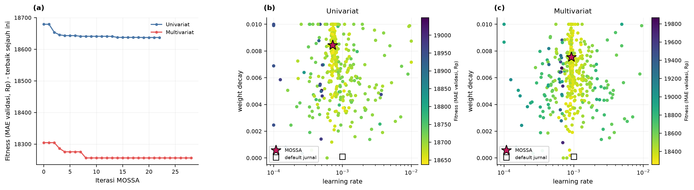

```
src/config.py                            ML_MODELS, DL_MODELS, MOSSA_* (pop 20, iter 100)
notebooks/05_dpformer.ipynb              2 setup × 5 horizon + tuning MOSSA
outputs/results/mossa_dpformer.json         hasil MOSSA (lr, weight_decay) dan jumlah iterasi
```

---

# Notebook 06 — Deep learning: 10 baseline

### ❓ Pertanyaan yang dijawab

*Bagaimana 10 baseline DL dilatih agar perbandingan adil dan bisa diperiksa pihak luar?*

### 💡 Penjelasan

Notebook ini melatih **10 baseline DL × 5 horizon × 2 setup = 100 run**: LSTM, GRU, BiLSTM, BiGRU, Transformer, DLinear, NLinear, PatchTST, LSTM+Attention, dan GRU+Attention. Semuanya memakai hiperparameter **seragam** `AdamW` dengan `lr` = 1e-3 dan `weight_decay` = 1e-4 (tanpa tuning), jendela `SEQ_LEN = 10` hari, *z-score* yang di-*fit* hanya pada data latih, dan kanal eksogen di-*clip* ±5 (`EXO_CLIP`). *Early stopping* memakai baris validasi **ber-embargo** (Notebook 04). DPformer (dengan `lr` dan `weight_decay` hasil MOSSA) dilatih di Notebook 05, bukan di sini; kestabilan lintas *seed* diuji di Notebook 13.

**Kenapa mengacu ke Bao et al. (2026)?** Konfigurasi 10 baseline DL mengikuti
*Table 3* paper tersebut sedekat mungkin (rumus *as-published*, tidak dituning ulang),
supaya ada acuan eksternal yang bisa diperiksa reviewer.

### 📁 Bukti di repo

```
src/models_dl.py                         11 arsitektur DL
notebooks/06_dl_models.ipynb             10 baseline DL
outputs/results/models/                bobot model multivariat h=20 (.weights.h5), dipakai SHAP
```

---

# Notebook 07 — Machine learning: 10 model dan benchmark Drift

### ❓ Pertanyaan yang dijawab

*Apa saja 10 model ML, apa aturan anti-kebocorannya, dan apa itu benchmark Drift?*

### 💡 Penjelasan

Notebook ini melatih **10 model ML × 5 horizon × 2 setup = 100 run**: LightGBM, XGBoost, Random Forest, CatBoost, Gradient Boosting, SVR, Extra Trees, HistGradientBoosting, AdaBoost, dan ElasticNet. Aturan anti-kebocoran:

- split kronologis 70/10/20; *early stopping* model *boosting* (LightGBM, XGBoost, CatBoost) memakai baris validasi **ber-embargo**, sedangkan model non-*boosting* tidak memakai validasi;
- fitur lag/rolling hanya memakai informasi sampai hari origin; makro sudah lag-1;
- *scaler* SVR/ElasticNet di-*fit* hanya pada data latih; data uji hanya dipakai sekali untuk evaluasi final;
- hiperparameter **tidak** dituning pada data uji (nilai tetap di `src/pipeline.py` dan `src/config.py`).

**Revisi konfigurasi `ml-r2` (SVR).** Versi lama memakai `epsilon = 0,02` pada target mentah; untuk h=1 simpangan baku return hanya ≈0,7%, sehingga seluruh target jatuh di dalam tabung-ε dan SVR hanya menghasilkan konstanta. Versi ini memakai target terstandardisasi (default sklearn `C=1`, `ε=0,1` pada satuan simpangan baku). Karena itu **seluruh ML dijalankan ulang otomatis**, dan hasil ML lama tanpa penanda `rev` dianggap basi. DL dan MOSSA **tidak** terpengaruh (protokol tidak berubah).

**Benchmark Drift** = `r̂ = μ_train`, rata-rata return h-hari pada periode latih (tetap
untuk seluruh periode uji). Benchmark ini sangat sederhana: ia tidak melihat apa pun
kecuali rata-rata masa lalu, tetapi pada deret dengan sinyal tipis ia **susah dikalahkan**.
Kalau model tidak bisa mengalahkannya, model itu belum terbukti berguna. Dua pembanding yang
lebih adaptif — Drift ekspansif dan Drift bergulir 250 hari — dipakai di Notebook 17 (MDE) dan
Notebook 17–18 (uji stres pembanding).

Drift disimpan sebagai benchmark diagnostik; ia **bukan** salah satu dari 21 model. Naif/*random-walk* murni tidak dipakai sebagai benchmark utama karena pada harga yang naik terus ia sistematis tertinggal; Drift lebih menantang untuk komoditas yang *trending*.

### 📁 Bukti di repo

```
notebooks/07_ml_models.ipynb             10 model ML
outputs/results/drift_benchmark.csv
```

---

# Notebook 08 — Tujuh pagar integritas

### ❓ Pertanyaan yang dijawab

*Bagaimana memeriksa bahwa angka-angka di Notebook 09–10 tidak dihasilkan oleh kebocoran
informasi?*

### 💡 Penjelasan

Ini bagian pembeda utama proyek. Kebocoran data (*lookahead*) **tidak menghasilkan
error** — ia menghasilkan **hasil yang terlalu bagus**, dan tidak ada yang memberi
peringatan. Salah satu cara paling andal menangkapnya adalah merusak data secara
sengaja lalu memastikan hasilnya tidak berubah.

Tujuh pagar, sesuai daftar kanonik di notebook 08:

| # | Pagar | Jenis |
|---:|---|---|
| 1 | Universum model = 21 (10 ML + 11 DL) | konsistensi |
| 2 | Data bersih: indeks, NaN, konsistensi fitur stasioner dengan level ber-lag, tanpa lookahead eksogen | konsistensi |
| 3 | Fitur latih/validasi **tidak berubah** ketika data uji dirusak | **mutation test** |
| 4 | Fitness DPformer (MOSSA) tidak bisa melihat uji; *early stopping* run final (ML & DL) tidak melihat harga periode uji | **mutation test** |
| 5 | Struktur walk-forward (embargo), skenario B (tanpa lookahead), SVR (ekuivarian terhadap skala target) | **mutation test** |
| 6 | Seluruh hasil utama memakai protokol/revisi/data yang sama dan **sejajar dengan data saat ini** | konsistensi |
| 7 | Diagnosis kurva loss seluruh 110 run DL: *skill* terhadap model nol + penanda overfit | diagnosis |

**Yang paling menarik dari pagar 3 dan 4 — angkanya:**

```
mae_val_asli            : 18904,92
mae_val_test_dirusak    : 18904,92      ← TIDAK BERUBAH, digit sama persis
mae_test_asli           : 63137,27
mae_test_test_dirusak   : 192339,70      ← justru BERUBAH drastis
```

Data uji dirusak habis-habisan: **fitness yang dipakai untuk memilih model tidak
bergerak sedikit pun**, sementara metrik uji berubah 3×. Artinya, pada jalur yang
diuji (pemilihan fitness MOSSA dan *early stopping*), metrik uji tidak dipakai —
pagar tersebut **sensitif** (ia bisa mendeteksi kebocoran), bukan sekadar lolos kosong.
Begitu juga untuk LightGBM: iterasi *early stopping* tetap **8 → 8**.

**Pagar 7 — diagnosis kurva loss (110 run DL).** Target DL di-*z-score* pada data latih, sehingga *model nol* (selalu memprediksi rata-rata target latih) punya MSE = 1 di data latih dan `val_null` di validasi (≠ 1 karena pergeseran rezim). Dari situ dua atribut dinilai **terpisah**:

| Atribut | Arti |
|---|---|
| **kelas** (skill epoch terbaik terhadap model nol di validasi, toleransi ±2%) | `BELAJAR` (lebih baik dari model nol) · `TANPA_SINYAL` (≈ model nol: hanya menemukan rata-rata) · `DI_BAWAH_NOL` (epoch terbaik pun lebih buruk dari model nol) |
| **overfit** (ya/tidak) | setelah epoch terbaik, *loss* validasi naik > 5% dari `val_null` sementara *loss* latih masih turun > 3% |

Bobot yang dipakai untuk uji adalah epoch terbaik (`restore_best_weights`), jadi *overfit* menjelaskan **bentuk kurva**, bukan model akhir yang rusak. Hasil (`diagnosis_loss.csv`): multivariat 4 `BELAJAR` · 25 `TANPA_SINYAL` · 26 `DI_BAWAH_NOL`; univariat 0 · 43 · 12; penanda *overfit* pada 39 dari 110 run. **Cara membaca:** return emas harian hampir efisien, jadi kurva yang datar mendekati model nol adalah perilaku yang **benar**, bukan bug, dan kurva "semua bagus" tidak bisa dipaksakan tanpa mengubah data. *Loss* validasi bisa lebih rendah daripada *loss* latih karena validasi (≈2021–2023) adalah periode *sideways* yang tenang (artefak rezim, Notebook 04, bukan kebocoran). `DI_BAWAH_NOL` pada multivariat berarti rata-rata target latih tidak cocok dengan validasi dan/atau model cepat menghafal fitur makro yang berisik — temuan yang dilaporkan, bukan alasan untuk mengutak-atik uji. Figur kurva loss lengkap ada di Notebook 12.

> **Catatan jujur dari notebook itu sendiri:** *overfit/underfit tidak bisa dijamin nol
> hanya dari kode. Yang bisa dibuat ketat: mencegah kebocoran, early stopping hanya
> dari validasi, dan mengukur gejalanya secara jujur tanpa memilih model berdasarkan uji.*

**Batas pagar ini:** ia menutup jalur kebocoran yang diuji dan **tidak membuktikan**
bahwa tidak ada jalur lain. Keputusan desain yang diambil setelah melihat data seluruh
sampel, misalnya, tidak tertangkap — Skenario B dirancang setelah melihat korelasi
lead–lag seluruh sampel, sehingga temuannya eksploratif (Notebook 03, 15, dan 19).

### 📁 Bukti di repo

```
notebooks/08_validasi_integritas.ipynb   daftar 7 pagar + seluruh output [OK]
src/checks.py                            9 fungsi cek_* yang merealisasikan 7 poin
outputs/results/diagnosis_loss.csv         diagnosis 110 run DL (pagar 7)
```

---

# Notebook 09 — Hasil dasar dan peringkat

### ❓ Pertanyaan yang dijawab

*Siapa model terbaik, dan seberapa banyak ia mengalahkan Drift?*

### 💡 Penjelasan

Notebook ini menggabungkan **10 ML + 11 DL = 21 model × 5 horizon × 2 setup = 210 hasil** (`tabel_hasil_final.csv`). Drift dilaporkan terpisah — ia bukan salah satu dari 21 model (definisinya di Notebook 07). Peringkat memakai **MAE uji**, yang ditetapkan setelah seluruh pemilihan hiperparameter selesai tanpa melihat data uji; `pct_vs_drift` positif = model lebih baik dari Drift.

**Model terbaik per horizon** (MAE di ruang harga; `% vs Drift` = persentase lebih baik):

| Horizon | Univariat | % vs Drift | Multivariat | % vs Drift |
|---:|---|---:|---|---:|
| 1 | PatchTST | 0,59 | LightGBM | 0,43 |
| 5 | SVR | 1,27 | Transformer | 1,97 |
| 10 | AdaBoost | 3,78 | AdaBoost | 3,87 |
| 20 | AdaBoost | 6,77 | AdaBoost | 4,76 |
| 30 | RandomForest | 3,21 | PatchTST | 2,43 |

**Peringkat rata-rata keseluruhan** (berdasarkan MAE, di seluruh 10 sel: 2 setup × 5 horizon):

| Model | `mean_rank` | Menang di… |
|---|---:|---|
| **AdaBoost** | **2,8** | 4 dari 10 sel |
| RandomForest | 6,1 | 1 |
| ElasticNet | 6,3 | 0 |

Tiga hal menarik yang layak disebut lebih dulu daripada ditanya:

1. **Pemenangnya bukan model yang canggih.** AdaBoost — boosting klasik — punya
   peringkat rata-rata 2,8, sedangkan Transformer 9,8, PatchTST 8,8, dan DPformer 10,0.
   Ini sejalan dengan dugaan bahwa kalau sinyalnya tipis, model besar lebih mudah
   menghafal kebisingan — tetapi dugaan itu belum diuji langsung di sini.
2. **Selisihnya kecil.** Bahkan pemenang hanya 0,43–6,77% lebih baik dari Drift.
   Angka ini **belum** diuji statistik — itu pekerjaan Notebook 10, dan hasilnya jauh lebih
   suram daripada tabel ini menunjukkan. Secara keseluruhan MAE model lebih baik dari
   Drift pada 108 dari 210 run (51,4%).
3. **Sebagian selisih itu kemungkinan pergeseran level, bukan kemampuan meramal.** Rata-rata
   return harian periode uji (reli) ≈ 3,7× rata-rata periode latih, padahal Drift memakai
   rata-rata periode latih yang tetap. Pengujiannya (konstanta *oracle* dan pembanding Drift adaptif) ada di Notebook 17 dan 18.

**Metrik di ruang return, model wakil, dan figur.** Harga Antam naik ≈3× di periode uji, jadi MAE dalam rupiah didominasi 2025–2026. Karena itu notebook ini juga menghitung metrik di ruang **return h-hari** (`metrik_return.csv`): RMSE dan MAE return, `R2oos_vs_drift` (= 1 − MSE model / MSE Drift; positif = lebih baik dari Drift), rasio simpangan baku prediksi terhadap aktual (`std_ratio`; mendekati 0 berarti prediksi hampir konstan), korelasi, dan akurasi arah. **Tiga model wakil** dipilih otomatis dengan aturan deterministik — peringkat rata-rata MAE di dalam kelompok pada 10 kondisi (2 setup × 5 horizon), pemutus seri rata-rata `pct_vs_drift`, DPformer selalu ikut — yaitu **DPformer**, **GRU+Attention** (DL baseline terbaik), dan **AdaBoost** (ML terbaik), disimpan di `wakil_model.json`. Pemilihan ini deskriptif pasca-evaluasi, bukan tuning, dan dipakai oleh SHAP (Notebook 11) serta analisis tambahan (Notebook 12, 14, 15, 16). **Hati-hati membaca figur harga:** kurva prediksi yang tampak mengikuti aktual pada harga *level* sebagian besar karena harga hari ini sudah memuat hampir seluruh informasi (*persistence*); untuk gambaran yang tidak menyesatkan lihat panel return dan `R2oos_vs_drift`.

### 📁 Bukti di repo

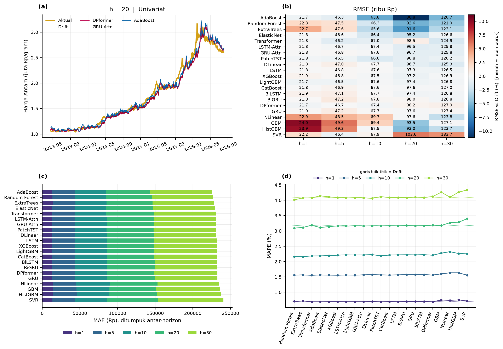

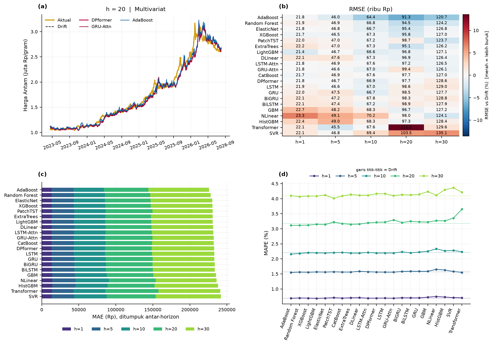

```
outputs/results/model_terbaik_per_horizon.csv   tabel di atas
outputs/results/ringkasan_model.csv             mean_rank, wins
outputs/results/tabel_hasil_final.csv           210 baris lengkap
outputs/results/metrik_return.csv
outputs/results/wakil_model.json
notebooks/09_hasil_dan_ranking.ipynb
```

---

# Notebook 10 — Uji statistik (DM, BH-FDR, MCS, arah)

> **Bagian ini (bersama Notebook 17) paling mungkin ditanya.** Kalau hanya sempat satu bagian, baca yang ini dan Notebook 17.

### ❓ Pertanyaan yang dijawab

*Angka-angka Notebook 09 itu nyata atau kebetulan — dan kalau ternyata hampir semua tidak
signifikan, apa kontribusinya?*

### 💡 Penjelasan

**Empat lapis uji, berurutan dari longgar ke ketat.**

**Lapis 1 — Diebold–Mariano dengan koreksi HLN.** Menguji apakah galat kuadrat return model
signifikan lebih kecil daripada Drift (satu sisi). 210 uji (21 model × 2 setup × 5 horizon).

**Lapis 2 — Koreksi Benjamini–Hochberg (BH-FDR).** Dengan 210 uji, pada taraf 5% kita
mengharapkan sekitar 10,5 uji (210 × 5%) bernilai `p < 0,05` hanya karena kebetulan,
*seandainya tidak ada efek sama sekali*. Tanpa koreksi, "16 uji mengalahkan Drift pada
`p < 0,05`" tidak jauh dari angka yang diharapkan dari kebetulan — jadi angka itu
menyesatkan kalau dibaca sebagai 16 model yang terbukti lebih baik.

**Lapis 3 — Model Confidence Set (MCS) 90%.** Bukan memilih pemenang, tetapi
menanyakan: *set mana yang masih layak disebut pemenang?* Kalau setnya berisi semua
orang, tidak ada pemenang.

**Lapis 4 — Selang kepercayaan + MDE** (dihitung di Notebook 17). Berapa besar perbedaan yang **bisa** kita
deteksi dengan daya uji yang tersedia? Ini yang mengubah makna "tidak signifikan".

**Catatan metode (dari notebook).**

- **DM + HLN**, satu sisi (H1: model lebih baik dari pembanding). Forecast h-langkah dengan origin harian saling tumpang-tindih, sehingga selisih *loss* berautokorelasi sampai lag *h−1*; varians jangka panjang memakai **kernel persegi sampai lag h−1** (bentuk asli DM) + koreksi HLN dan distribusi *t*. Versi lama memakai kernel Bartlett + normal, yang terlalu mudah menolak H0. *Loss* utama ada di **ruang return** (bebas skala; sama dengan target latih): *loss* di ruang harga (rupiah²) didominasi 2025–2026 karena harga naik ≈3×, sehingga hanya disajikan sebagai pembanding.
- **BH-FDR 5%** dilaporkan pada dua keluarga: seluruh uji dalam satu setup (105 uji — ketat) dan per (setup, horizon) (21 uji — longgar).
- **MCS** (Hansen–Lunde–Nason, 2011): bootstrap blok, himpunan model yang tidak dapat dibedakan dari yang terbaik pada tingkat 90%; Drift ikut sebagai kandidat. MCS yang besar berarti data tidak cukup informatif untuk memisahkan model — itu sendiri temuan penting.
- **Multivariat vs univariat** (A = multivariat, B = univariat; `rel_mse_ret < 1` = multivariat lebih baik). Ingat bahwa fitur makro di eksperimen utama ber-lag-1 dan sebagian informasinya sudah ada di harga, jadi jawaban "tidak membantu" sebagian merupakan konsekuensi desain; Skenario B (Notebook 15) menguji versi hari-yang-sama.

---

**Hasilnya, apa adanya:**

| Uji | n | Lolos |
|---|---:|---|
| DM vs Drift — `rel_mse < 1` | 210 | **115** |
| DM vs Drift — `p < 0,05` | 210 | 16 |
| DM vs Drift — **lolos BH-FDR** (keluarga 21 uji: per setup×horizon) | 210 | **1** |
| DM vs Drift — lolos BH-FDR (keluarga 105 uji atau seluruh 210 uji) | 210 | 0 |
| Multivariat vs univariat — `rel_mse < 1` | 105 | 40 |
| Multivariat vs univariat — `p < 0,05` | 105 | 5 |
| Multivariat vs univariat — **lolos BH-FDR** (keluarga seluruh 105 uji) | 105 | **0** |
| Multivariat vs univariat — lolos BH-FDR (keluarga per horizon, 21 uji) | 105 | 2 |

> **Catatan soal "keluarga" (famili) uji.** Koreksi BH bergantung pada keluarga uji yang
> dikoreksi, dan pilihan keluarga mengubah hasilnya. **DM vs Drift:** dengan keluarga per
> setup×horizon (21 uji; `q_bh_setup_h`) **1** lolos; dengan keluarga per setup (105 uji;
> `q_bh_setup`, `q` terendah 0,2017) dan keluarga seluruh 210 uji (`q` terendah 0,2750;
> hitungan di `panduan_bimbingan/skrip/hitung_angka_tambahan.py`) **0** yang lolos.
> **Multivariat vs univariat:** dengan keluarga seluruh 105 uji (`q_bh`) **0** lolos;
> dengan keluarga per horizon (21 uji; `q_bh_h`) **2** lolos (GBM dan HistGBM di h=1,
> `q_bh_h` = 0,0138) — keduanya jatuh begitu keluarga diperluas. Jadi satu-satunya temuan
> DM vs Drift bergantung pada keluarga terkecil, dan dua temuan makro bergantung pada
> keluarga per horizon. Pilihan keluarga ini harus disebut apa adanya, bukan disembunyikan.

**Satu-satunya yang bertahan (keluarga 21 uji):**

```
setup       model          horizon   rel_mse   p_one_hln   q_bh_setup_h
univariat   transformer         1     0,9950     0,00195   0,0410
```

Efeknya kecil: MSE return hanya ≈ 0,5% lebih rendah daripada Drift (`rel_mse` 0,9950).
Sisanya tenggelam. MCS mengatakan hal yang sama dengan cara berbeda: **209 dari 220**
entri (22 model dan benchmark × 10 kombinasi setup×horizon) masuk *confidence set*, dan
**Drift sendiri masuk di seluruh 10 kombinasi** (2 setup × 5 horizon) — artinya Drift
tidak pernah bisa dikesampingkan.

**Akurasi arah (Pesaran–Timmermann).** Menguji apakah **tanda** return prediksi berasosiasi dengan tanda aktual (sampel tak-tumpang-tindih, *stride* h). Hasilnya tak terdefinisi (NaN) bila prediksi selalu satu tanda (mis. selalu naik), yang umum untuk model yang hampir konstan. Karena 52–69% hari uji adalah kenaikan, akurasi arah yang tinggi dapat berasal dari bias naik, bukan keahlian — karena itu PT dibandingkan dengan akurasi yang diharapkan secara kebetulan (`p_star`).

**Kesimpulan yang boleh (dan tidak boleh) ditulis** (dari notebook):

- Bila hampir tidak ada model yang lolos koreksi uji berganda dan Drift berada di dalam MCS, kesimpulan yang **jujur** adalah *tidak ada bukti statistik yang kuat bahwa satu model mengalahkan Drift secara konsisten pada return emas Antam*. Ini konsisten dengan hipotesis pasar yang hampir efisien dan **bukan** kegagalan penelitian, asalkan disertai analisis ketahanan (Notebook 12, 13, 16).
- Jangan menulis "model X terbaik secara signifikan" bila X tidak lolos DM terhadap Drift. Gunakan kalimat deskriptif ("MAE terendah pada kondisi …") dan sebutkan hasil uji.
- Hasil *p* < 0,05 yang tidak lolos BH bersifat eksploratori: dari 210 uji, ≈10 hasil *p* < 0,05 diharapkan muncul **hanya karena kebetulan**.

### 📁 Bukti di repo

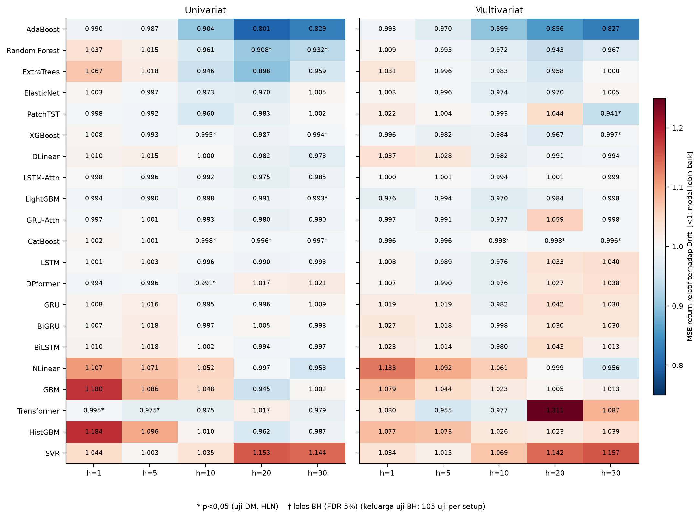

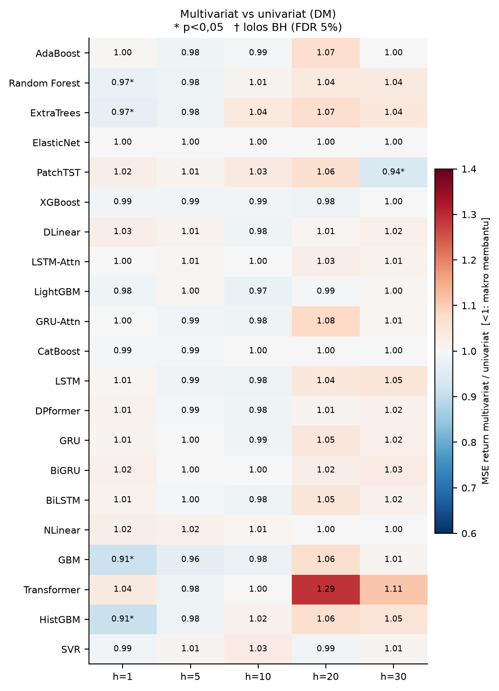

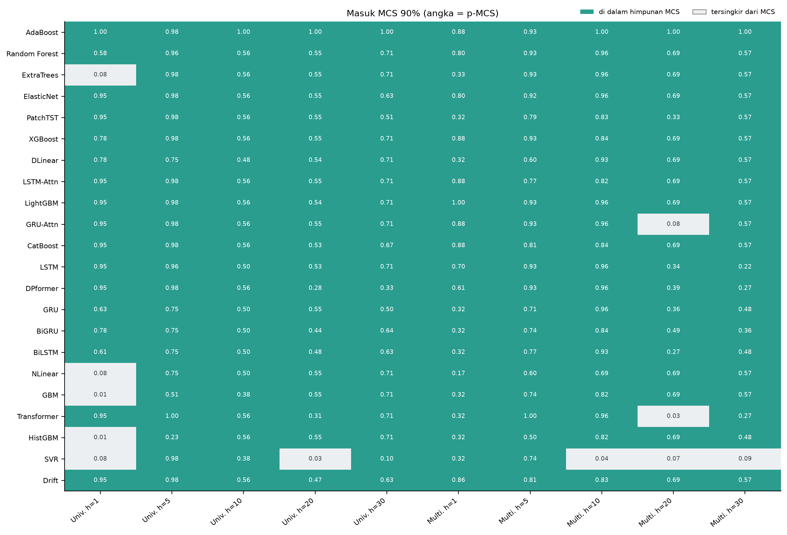

```
outputs/results/dm_vs_drift_detail.csv                210 baris, kolom q_bh_setup (105) dan q_bh_setup_h (21)
outputs/results/dm_multivariat_vs_univariat_detail.csv 105 baris, kolom q_bh (105) dan q_bh_h (21)
outputs/results/mcs_keanggotaan.csv                   22 entri × 10 kombinasi = 220; 209 True
panduan_bimbingan/skrip/hitung_angka_tambahan.py    BH pada keluarga 210 uji (q terendah 0,2750)
notebooks/10_uji_statistik.ipynb
```

---

# Notebook 11 — Interpretasi (SHAP)

### ❓ Pertanyaan yang dijawab

*Model yang sudah dilatih, sebenarnya memakai apa untuk memutuskan?*

### 💡 Penjelasan

SHAP dijalankan pada **tiga model wakil** di setup multivariat h=20: **DPformer**,
**GRU+Attention** (wakil DL), dan **AdaBoost** (wakil ML). Untuk model DL dipakai
`GradientExplainer` — metode pendekatan, galat kelengkapan (`completeness_err`) ≈ 0,10 —
sedangkan untuk AdaBoost `PermutationExplainer`, yang eksak (galat ≈ 10⁻¹⁵). Latar
belakang 50 sampel dan 100 sampel yang dijelaskan. Hanya satu setup dan satu horizon yang
dijelaskan, jadi tabel berikut tidak boleh digeneralisasi ke horizon lain.

Temuannya **berbeda jauh antara model DL dan model ML**, dan perbedaan itu justru
mengkonfirmasi Notebook 09:

| Variabel | DPformer | GRU-Attn | **AdaBoost** |
|---|---:|---:|---:|
| US 10Y | **22,4%** | **20,0%** | 1,2% |
| DXY | 17,9% | 13,6% | 1,2% |
| S&P 500 | 14,9% | 12,1% | 16,2% |
| IHSG | 14,0% | 15,9% | 3,0% |
| **Emas (lag & rolling)** | 11,6% | 10,5% | **75,8%** |
| BI-Rate | 8,4% | 9,3% | 0,0% |
| USD/IDR | 7,8% | 11,9% | 2,4% |
| FFR | 3,2% | 6,6% | 0,2% |

**Cara membaca:** model DL **memberi bobot besar pada makro global** (DXY + S&P 500 +
US 10Y + FFR = **58%** pada DPformer dan **52%** pada GRU-Attn), sedangkan AdaBoost
**hampir sepenuhnya mengandalkan harga emasnya sendiri** (75,8%; kelompok makro global tadi
hanya 19%). Padahal AdaBoost itu model yang peringkat rata-ratanya lebih baik.

Ini sejalan dengan temuan Notebook 10 bahwa fitur makro (lag-1) tidak terbukti menambah
informasi: model yang paling bergantung pada makro bukan yang terbaik. Tetapi hati-hati:
SHAP mengukur **ketergantungan model**, bukan **manfaat akurasi** — bobot besar pada suatu
variabel tidak berarti variabel itu memperbaiki ramalan, dan dua jenis penjelas (gradien
vs permutasi) membatasi perbandingan langsung antar-kolom.

### 📁 Bukti di repo

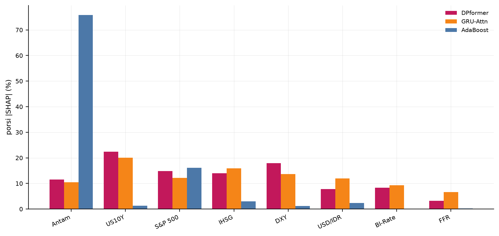

```
outputs/results/shap/shap_ringkasan.json                 wakil, metode, completeness_err
outputs/results/shap/shap_porsi_per_model.csv            tabel di atas
outputs/results/shap/shap_*_importance.csv               detail per model
notebooks/11_interpretasi_shap.ipynb
```

---

# Notebook 12 🆕 — Analisis tambahan pasca-evaluasi

### ❓ Pertanyaan yang dijawab

*Apakah keunggulan terhadap Drift stabil antar-periode dan rezim, dan apa kata kurva loss, galat, serta feature importance bawaan model?*

### 💡 Penjelasan

> 🆕 **Bagian ini disusun dari narasi dan output Notebook 12**; versi dokumen sebelumnya belum membahasnya. Angkanya diambil dari output notebook dan CSV hasil.

Notebook ini **tidak melatih model apa pun**: ia membaca prediksi dan *history* yang sudah tersimpan. Pengelompokan (blok waktu, rezim) hanya memakai informasi yang tersedia **di hari origin**, batas rezim dihitung dari **data latih** saja, dan tiga model wakil (DPformer, GRU+Attention, AdaBoost; Notebook 09) dipilih secara deskriptif pasca-evaluasi.

**1. Kurva loss dan diagnosis (110 run DL).** Kelas diagnosis dari Notebook 08 (pagar 7) di sini dirangkum dan digambar untuk semua setup × horizon (`fig_loss_<setup>_h<h>`). Hasilnya: multivariat 4 `BELAJAR` · 25 `TANPA_SINYAL` · 26 `DI_BAWAH_NOL` (33 run *overfit*; epoch terbaik median 2); univariat 0 · 43 · 12 (6 run *overfit*; epoch terbaik median 3). DLinear dan NLinear (model linear berkapasitas kecil) konvergen lambat — epoch terbaik median 62 dan 69 pada multivariat — dan tidak ada yang *overfit*, tetapi seluruh 5 run multivariat keduanya berada di `DI_BAWAH_NOL`. Return emas harian hampir derau, jadi kurva yang turun sedikit lalu mendatar di sekitar model nol adalah kurva yang **sehat**, bukan bug.

**2. Stabilitas antar-blok waktu dan rezim volatilitas.** Periode uji dibagi 4 blok sama panjang (h=20: 2023-04-17 s.d. 2024-02-12, 2024-02-13 s.d. 2024-12-09, 2024-12-10 s.d. 2025-10-06, 2025-10-07 s.d. 2026-08-03; 215–216 baris per blok). Untuk tiap model dihitung rasio MSE-return model/Drift per blok (< 1 = lebih baik dari Drift). Keunggulan **tidak stabil**: pada blok 1, hanya 0–5 dari 21 model yang lebih baik dari Drift pada h ≥ 5 (median rasio hingga 1,286 pada multivariat h=30), sedangkan pada blok 3 (2024-12 s.d. 2025-10) 20 dari 21 model lebih baik pada multivariat h=5 dan h=10. Pada rezim volatilitas **tenang** (volatilitas realisasi 20 hari di origin; batas tercile dari data latih), median rasio berada di atas 1 pada 9 dari 10 sel setup × horizon (mis. 1,137 pada multivariat h=1), sedangkan pada rezim sedang dan tinggi kira-kira 1. Jadi keunggulan yang hanya muncul pada sebagian blok atau rezim **bukan** keunggulan yang stabil; Notebook 16 menguji hal yang sama pada enam periode uji berbeda.

**3. MSE return bergulir.** Rasio MSE-return model/Drift pada jendela bergulir 120 hari origin untuk tiga model wakil, digambar bersama volatilitas 20 hari.

**4. Diagnostik galat tiga model wakil.** Histogram, QQ-plot, dan ACF galat (ACF wajar tinggi sampai lag *h−1* karena galat h-langkah bertumpang-tindih). Pada h=20, rata-rata return aktual periode uji adalah 2,18%, sedangkan rata-rata prediksi DPformer hanya ≈0,5% (univariat) dan ≈0,4% (multivariat), GRU+Attention ≈0,7% dan ≈0,5%, serta AdaBoost ≈2,4% dan ≈2,0%. Rata-rata galat (aktual − prediksi; positif = meramal terlalu rendah) ≈ +1,7% untuk DPformer dan GRU+Attention, tetapi −0,23% (univariat) dan +0,14% (multivariat) untuk AdaBoost. Model yang meramal terlalu rendah selama reli adalah sifat rezim uji (model dilatih pada periode dengan tren naik lebih lemah), **bukan** indikasi kebocoran.

**5. *Feature importance* bawaan model ML** (multivariat, h=20; porsi per variabel, seluruh fitur turunan Antam digabung). Tabel memuat 8 model. Untuk 7 di antaranya fitur Antam sendiri (lag dan rolling) memegang porsi terbesar (59,6%–77,0%); pengecualiannya CatBoost (S&P 500 56,3% vs Antam 31,8%). Skala *importance* berbeda antar-keluarga model, jadi bandingkan **pola**, bukan angka mutlak; SHAP (Notebook 11) lebih sebanding.

**6. Perbaikan MAE terhadap Drift sepanjang horizon** (`fig_perbaikan_vs_horizon`; 21 model, garis tebal = median, tiga wakil disorot). Median seluruh model berada di −1,86% s.d. +0,69% terhadap Drift pada 10 sel (setup × horizon) — hampir 0%: **tidak ada keunggulan sistematis**. Model terbaik per sel sama dengan tabel Notebook 09 (0,43%–6,77% lebih baik dari Drift), sedangkan yang terburuk −4,15% s.d. −14,06%.

**Ringkasan yang dapat dipakai di naskah** (dari notebook): (a) median seluruh model sekitar 0% terhadap Drift di semua horizon, jadi selisih beberapa persen pada MAE mudah muncul karena variasi sampel (cek DM dan MCS di Notebook 10); (b) keunggulan model individual (mis. AdaBoost pada h=10 dan h=20) bergantung pada blok dan rezim periode uji dan tidak dijadikan klaim umum; (c) kurva loss DL berada pada kelas *tanpa sinyal* atau *di bawah model nol* (hanya 4 dari 110 run `BELAJAR`) — konsisten dengan hipotesis pasar yang hampir efisien.

### 📁 Bukti di repo

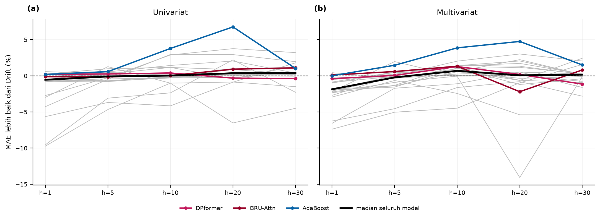

```
outputs/results/diagnosis_loss.csv
outputs/results/stabilitas_blok.csv
outputs/results/stabilitas_rezim.csv
outputs/results/importance_ml_porsi_variabel.csv
outputs/figures/fig_loss_kelas.png         + fig_loss_<setup>_h<h> (kurva loss per setup × horizon)
notebooks/12_analisis_tambahan.ipynb
```

---

# Notebook 13 — Ketahanan: seed acak

> **Notebook 13–16 dan 19 adalah uji ketahanan** — empat serangan berbeda terhadap hasil yang sama: seed acak (13), ablation (14), walk-forward (16), dan Skenario B + plasebo (15, 19). Notebook 12, 17, dan 18 adalah analisis tambahan yang tidak melatih model. Pertanyaan bersama untuk blok ini: *apakah temuan di bagian-bagian sebelumnya bertahan ketika berubah periode, seed, atau konfigurasi — dan bisakah dibuktikan bukan artefak?*

### ❓ Pertanyaan yang dijawab

*Seberapa besar hasil DL bergantung pada seed acak?*

### 💡 Penjelasan

**Seed acak.** 6 dari 11 model DL (DLinear, NLinear, GRU, GRU+Attention,
LSTM+Attention, DPformer; LSTM, BiLSTM, BiGRU, Transformer, dan PatchTST tidak diulang) ×
2 setup × 5 horizon × 5 seed (42–46) = **60 kombinasi** (300 run). Hasil: **CV MAE
0,034% – 1,30%**, median **0,29%**, dan rentang MAE antar-arsitektur dalam satu sel =
**5–28×** simpangan baku antar-seed. Jadi variasi seed kecil dibanding selisih
antar-arsitektur (di antara 6 model itu). Tetapi **urutan**
arsitektur belum stabil: model terbaik sama di kelima seed hanya pada **1 dari 10** sel
setup×horizon, dan korelasi peringkat (Spearman) antar-seed 0,65–0,93 (median 0,82) —
jadi peringkat yang tipis di Notebook 09 jangan dibaca terlalu kuat. (Perhitungan peringkat ini
dari `multiseed_semua.csv`, dengan `panduan_bimbingan/skrip/hitung_angka_tambahan.py`;
belum ada di notebook 13.)

### 📁 Bukti di repo

```
outputs/results/multiseed_ringkasan.csv            60 baris, kolom CV_pct
outputs/results/multiseed_semua.csv                300 run (dasar hitungan peringkat antar-seed)
panduan_bimbingan/skrip/hitung_angka_tambahan.py    peringkat antar-seed (belum ada di notebook)
notebooks/13_uji_robustness_seed.ipynb
```

---

# Notebook 14 — Ablation: kelompok fitur dan tuning MOSSA

### ❓ Pertanyaan yang dijawab

*Variabel makro mana (kalau ada) yang membantu, dan apakah tuning MOSSA pada DPformer berguna?*

### 💡 Penjelasan

**Ablasi.** Dua bagian. (a) *Kelompok fitur*: univariat (A) vs makro
global (B: DXY, S&P 500, US 10Y, FFR) vs makro domestik (C: USD/IDR, IHSG, BI-Rate) vs
seluruh makro (D), pada tiga model wakil (DPformer, GRU+Attention, AdaBoost) di h=5 dan
h=20 — 18 uji terhadap kelompok A, **0 signifikan** (`q` terendah 0,78). (b) *MOSSA vs
default* (**0/10 lolos BH**), dibahas di bawah.

**Pembacaan ablasi kelompok fitur.** Karena 0 dari 18 uji terhadap kelompok A signifikan (`q` terendah 0,78), tidak ada bukti bahwa menambah variabel makro lag-1 — global maupun domestik — memberi informasi tambahan bagi tiga model wakil. Itu tidak berarti "multivariat gagal": waktu informasi diuji di Notebook 15 dan 19.

**Tuning MOSSA vs default.** DPformer dengan `lr` dan `weight_decay` hasil MOSSA dibandingkan dengan DPformer **tanpa tuning** (`lr` 1e-3, `weight_decay` 1e-4; *Table 3* jurnal acuan) pada seluruh horizon dan kedua setup; *seed*, arsitektur, data, dan split sama. Hasilnya menjawab pertanyaan keadilan yang hampir pasti ditanyakan:

**Apakah tuning hanya untuk DPformer itu tidak adil?** Pertanyaan yang tepat, dan
sebagian jawabannya diukur: ablation MOSSA vs default pada 10 sel (setup × horizon)
menunjukkan **0 dari 10 lolos BH-FDR** (nilai `q` terendah 0,0713), dan MOSSA lebih baik
di 4 dari 10 sel menurut MAE. Artinya manfaat tuning ekstra itu **tidak terbukti** — itu
bukan bukti bahwa tuning tidak berpengaruh. Argumen yang lebih kuat: ketidaksimetrian ini
hanya menguntungkan DPformer, dan DPformer tetap tidak mengungguli Drift secara konsisten
(tak satu pun uji DPformer vs Drift lolos BH), sehingga kecil kemungkinannya mengubah
kesimpulan utama. Ini harus disebut kalau ditanya — lebih baik kita yang mengangkatnya
lebih dulu.

### 📁 Bukti di repo

```
outputs/results/ablation_ringkasan.csv              ablasi kelompok fitur (18 uji vs kelompok A)
outputs/results/ablation_mossa_vs_default.csv       0/10 lolos BH
outputs/figures/fig_ablation_fitur.png
outputs/figures/fig_mossa_vs_default.png
notebooks/14_ablation_study.ipynb
```

---

# Notebook 15 — Skenario B: informasi penutupan hari-t

### ❓ Pertanyaan yang dijawab

*Apa yang berubah bila penutupan pasar hari-t (bukan hari t−1) boleh dipakai untuk meramal t+1?*

### 💡 Penjelasan

Pada protokol utama semua indikator makro di-lag 1 hari kerja. Pemeriksaan lead–lag (Notebook 03) menunjukkan bahwa harga Antam hari *t* sudah memuat sebagian besar informasi penutupan pasar AS hari *t−1*, sedangkan korelasi penutupan **hari t** dengan return *t+1* jauh lebih besar. Jadi desain lag-1 **konservatif** (aman dari kebocoran) tetapi bisa membuang informasi yang sebenarnya sudah tersedia saat peramalan. Notebook ini menjalankan **Skenario B** sebagai analisis sensitivitas — bukan pengganti protokol utama.

**Apa yang diuji.** *Skenario B* memakai penutupan pasar **hari-t** (DXY, S&P 500,
USD/IDR, IHSG, US 10Y; FFR dan BI-Rate tetap lag-1) untuk meramal return t+1 — ramalan
dibuat **malam hari**, setelah pasar hari-t tutup dan **sebelum** harga Antam hari t+1
diumumkan. Itu layak hanya bila pengumuman Antam t+1 memang jatuh setelah penutupan pasar
AS hari-t. Berkas mentah mencatat jam untuk 82% hari kerja (median 08:18; P5–P95
07:50–09:02; zona waktu diasumsikan WIB), yang mendukung asumsi itu — tetapi **belum
diverifikasi dengan catatan resmi Antam**. (Teks notebook 15 dan 19 menyebut dataset tidak
mencatat jam; hitungan di atas dari `panduan_bimbingan/skrip/audit_data_mentah.py`.)

**Hasil pada h=1** (12 model: 10 ML + 2 DL wakil; `skenario_b_vs_multivariat_lag1.csv`): median
`rel_mse` **0,9267**, **11 dari 12 lolos BH** (keluarga 60 uji). Median 0,9266 vs 0,9267
berbeda karena sumbernya: notebook 19 membandingkan pada irisan baris (n = 863), notebook 15
memakai seluruh baris uji (n = 864).

Di luar h=1 ada satu pengecualian pada varian 12 model: DPformer h=20 (`rel` 0,9714; `q` 0,0149 pada keluarga
60 uji dan 0,0297 per horizon) — tidak muncul pada 10 model ML (Notebook 19), jadi tidak dijadikan
temuan utama.

Perbaikan yang terkonsentrasi di horizon pendek masuk akal: korelasi harian antar-pasar meluruh seiring horizon. Untuk memakai Skenario B di naskah, tuliskan asumsi waktu publikasi harga Antam secara eksplisit dan, bila bisa, verifikasi dengan jam publikasi resmi.

### 📁 Bukti di repo

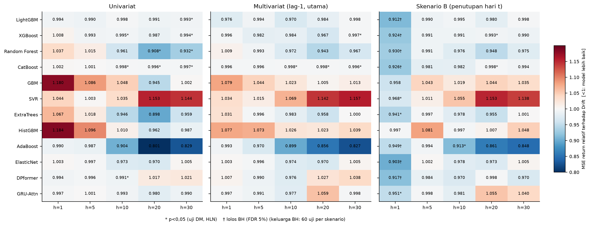

```
outputs/results/skenario_b_vs_multivariat_lag1.csv  11/12 lolos BH di h=1
notebooks/15_skenario_b.ipynb
```

---

# Notebook 16 — Walk-forward

### ❓ Pertanyaan yang dijawab

*Apakah kesimpulan bergantung pada satu periode uji yang kebetulan reli?*

### 💡 Penjelasan

**Walk-forward (*rolling-origin*).** Daripada mengandalkan satu periode uji, origin
digulirkan: **6 fold × 260 hari** (origin ≈ 2020-07/08 s.d. 2026-07), diuji pada h=5 dan
h=20 dengan 12 model (memakai `lr`/`weight_decay` default, bukan hasil MOSSA). Hasil: dari
48 uji (12 model × 2 setup × 2 horizon), 18 punya `rel < 1`, **0** dengan `p < 0,05`, dan
**0 lolos BH-FDR** (`q_bh` terendah 0,794; pada famili per horizon `q_bh_h` terendah
0,397). Ini cek konsistensi atas Notebook 10 pada periode yang lebih panjang, bukan replikasi
yang independen: fold 4–6 seluruhnya dan fold 3 sebagian berada di dalam periode uji
utama. Arah pasarnya pun tidak seimbang: harga naik pada 11 dari 12 jendela fold×horizon
(+1% s.d. +40%; satu jendela turun 7,9%).

**Rincian desain (dari notebook).**

- Jendela belajar **melebar** (*expanding window*); tiap fold punya blok uji ± 1 tahun hari kerja (260 hari), 6 fold berurutan sampai data terakhir.
- Baris yang boleh dipakai belajar pada fold *k* hanyalah origin yang **label h-harinya sudah diketahui sebelum origin uji pertama** (embargo h hari otomatis); 10% terakhirnya dipakai sebagai validasi (*early stopping*), sisanya latih.
- Drift tiap fold = rata-rata return h-hari pada data latih fold itu.
- Model: 10 ML + dua DL wakil dengan `lr`/`weight_decay` **default** (1e-3 / 1e-4). Hasil MOSSA **tidak dipakai**, karena MOSSA dituning pada validasi split utama (2021–2023) yang berada di dalam blok uji beberapa fold — memakainya akan membocorkan informasi.
- Uji DM dihitung per fold dan **gabungan** seluruh fold (deret selisih-*loss* berurutan; koreksi HLN; BH). Tidak ada pemilihan model dari hasil ini.

### 📁 Bukti di repo

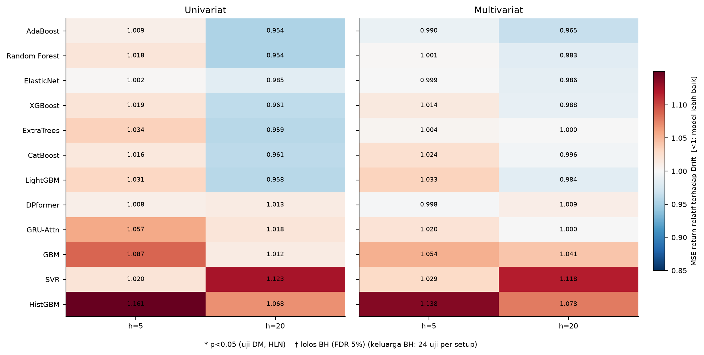

```
outputs/results/walkforward_gabungan.csv            48 uji, 0 lolos BH
panduan_bimbingan/skrip/hitung_angka_tambahan.py    arah harga per jendela fold × horizon (11 dari 12 naik)
notebooks/16_walk_forward.ipynb
```

---

# Notebook 17 — Selang kepercayaan dan daya uji (MDE)

### ❓ Pertanyaan yang dijawab

*Hasil nol itu berarti "tidak ada efek" atau "data terlalu sedikit untuk melihatnya" — dan perbaikan sebesar apa yang sudah tersingkir oleh data?*

### 💡 Penjelasan

Notebook 10 menjawab "apakah model lebih baik dari Drift?" dengan *p-value*, dan hasil utamanya nol. Hasil nol **bukan** bukti bahwa tidak ada efek: *p-value* besar berarti *tidak ada efek* **atau** *data terlalu sedikit untuk melihatnya*. Notebook ini adalah **lapis 4** dari empat lapis uji (Notebook 10) dan membedakan keduanya secara kuantitatif, **tanpa melatih ulang apa pun** (sumbernya prediksi tersimpan 21 model × 2 setup × 5 horizon):

1. **Selang kepercayaan 95%** untuk rasio MSE-return model/pembanding (dari statistik DM–HLN yang sama dengan Notebook 10): perbaikan sebesar apa yang *sudah tersingkir* oleh data. "Tersingkir" didefinisikan sebelum dijalankan: batas bawah selang 95% > 0,95 (perbaikan MSE ≥ 5% tersingkir) dan > 0,90 (≥ 10%).
2. **Efek terkecil yang terdeteksi (MDE)**: perbaikan MSE relatif terkecil yang uji ini dapat lihat dengan daya 80% (uji satu sisi 5%) — yaitu seberapa besar efek yang *tidak mungkin terlihat* dengan jumlah data uji ini. MDE = (z₀,₉₅ + z₀,₈₀) × galat baku / MSE pembanding.
3. **Uji stres pembanding.** Selain Drift resmi, dihitung dua pembanding **adaptif dan kausal** tanpa parameter terlatih: *Drift ekspansif* dan *Drift bergulir 250 hari* (jendela satu tahun kerja, tidak dituning), yang hanya memakai label yang sudah terselesaikan pada origin. Alasannya: periode uji adalah reli panjang, sehingga Drift resmi (rata-rata periode latih) tertinggal secara sistematis pada horizon panjang, dan model yang sekadar menaikkan rata-rata prediksinya tampak "mengalahkan Drift".

**Berapa banyak yang sudah tersingkir.** Dari 42 kombinasi (21 model × 2 setup), jumlah yang perbaikan MSE ≥ 5%-nya **sudah tersingkir** pada tingkat 95% (`n_tersingkir_5pct` di `ci_ringkasan_per_horizon.csv`):

| Horizon | vs Drift tetap | vs Drift ekspansif | vs Drift bergulir 250 hari |
|---:|---:|---:|---:|
| 1 | 40 | 40 | 40 |
| 5 | 31 | 35 | 8 |
| 10 | 17 | 25 | 2 |
| 20 | 23 | 26 | 0 |
| 30 | 28 | 26 | 0 |

Terhadap Drift tetap, perbaikan ≥ 5% sudah tersingkir untuk hampir semua kombinasi pada h=1 (40 dari 42), tetapi hanya 17 dari 42 pada h=10: pada horizon panjang data tidak cukup untuk menyingkirkan perbaikan sebesar itu. Terhadap Drift bergulir hampir tidak ada yang tersingkir pada h ≥ 10 (2, 0, 0), karena selang kepercayaannya sangat lebar (MDE 21–70% pada h=10–30).

**Lalu, daya ujinya bagaimana?**

Ini bagian yang paling sering disalahpahami. Median **observasi independen** per
horizon (`n_eff` = `n` ÷ h: return h-hari yang saling tumpang-tindih tidak independen,
jadi `n` efektif jauh lebih kecil dari jumlah baris), dan MDE terhadap tiga pembanding:

| Horizon | Baris uji | `n_eff` median | MDE vs Drift (tetap) | MDE vs Drift ekspansif | MDE vs Drift **bergulir** |
|---:|---:|---:|---:|---:|---:|
| 1 | 864 | 864,0 | 3,42% | 3,43% | 4,16% |
| 5 | 864 | 172,8 | 4,48% | 4,29% | 12,03% |
| 10 | 863 | 86,3 | 5,09% | 4,83% | 21,26% |
| 20 | 861 | 43,1 | 6,55% | 9,77% | **48,12%** |
| 30 | 859 | **28,6** | 5,79% | 9,06% | **70,42%** |

*MDE = Minimum Detectable Effect — penurunan MSE relatif terkecil terhadap pembanding yang
masih bisa dideteksi (uji satu sisi 5%, daya 80%; median dari 42 kombinasi per horizon;
`ci_ringkasan_per_horizon.csv`). MDE besar berarti **daya uji rendah** — selisih galat
terhadap Drift bergulir (jendela 250 hari) lebih berisik — bukan berarti pembandingnya
"lebih sulit dikalahkan".*

Artinya: terhadap Drift **tetap** (benchmark utama) MDE hanya 3,4–6,6% di semua horizon,
tetapi terhadap Drift **bergulir** pada h=30 kita baru bisa mendeteksi perbedaan
**sebesar 70%**. Kalaupun ada model yang lebih baik 10% terhadap pembanding bergulir itu,
**kita tidak punya cukup data untuk membuktikannya**. Karena itu:

> **"Tidak signifikan" ≠ "tidak ada efek." Untuk horizon panjang, itu berarti
> "daya ujinya tidak cukup."**

**Uji stres pembanding.** Jumlah kombinasi (dari 42) dengan `rel_mse < 1`, yaitu model lebih baik dari pembandingnya:

| Horizon | vs Drift tetap | vs Drift ekspansif | vs Drift bergulir 250 hari |
|---:|---:|---:|---:|
| 1 | 13 | 12 | 8 |
| 5 | 19 | 13 | 3 |
| 10 | 32 | 19 | 3 |
| 20 | 26 | 13 | 4 |
| 30 | 25 | 9 | 2 |

Terhadap Drift ekspansif atau bergulir, jumlah kombinasi dengan `rel_mse < 1` turun drastis: pada h=10, 32 → 19 → 3. Konstanta *oracle* yang menjadi batas atas pergeseran level ada di Notebook 18.

**Peringatan dan status (dari notebook).** Analisis ini **sekunder/eksploratif**: pembanding adaptif ditambahkan setelah hasil utama dilihat (*post hoc*). Selain itu: (i) hanya ada satu periode uji; (ii) jumlah jendela efektif (n/h) kecil, jadi bahkan selang HLN bisa terlalu optimistis; (iii) 42 selang kepercayaan tidak independen; (iv) model terbaik per horizon yang dipilih setelah melihat hasil terkena *winner's curse* (lihat kolom `rel_min_pascaseleksi`). **Yang tidak boleh ditulis:** "tidak ada hubungan" atau "model tidak berguna". **Yang boleh:** tidak ada bukti bahwa model mengalahkan Drift pada return, dan uji ini hanya mampu mendeteksi perbaikan sebesar MDE atau lebih.

### 📁 Bukti di repo

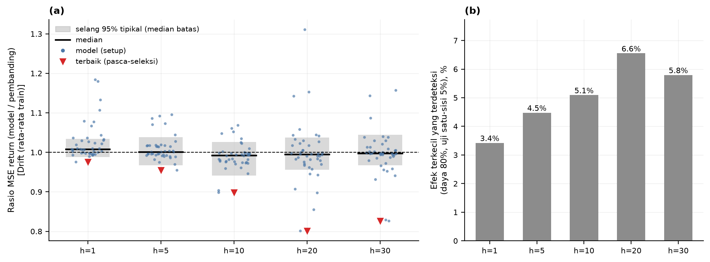

```
outputs/results/ci_ringkasan_per_horizon.csv          n_eff, MDE per horizon
outputs/results/ci_vs_pembanding_semua.csv
notebooks/17_selang_kepercayaan_vs_drift.ipynb
```

---

# Notebook 18 🆕 — Kombinasi bobot-sama dan Drift adaptif

### ❓ Pertanyaan yang dijawab

*Apakah rata-rata sederhana banyak model mengalahkan Drift, dan dari mana keunggulannya berasal?*

### 💡 Penjelasan

> 🆕 **Bagian ini disusun dari narasi dan output Notebook 18**; versi dokumen sebelumnya belum membahasnya (hanya satu angkanya, konstanta *oracle*, yang sebelumnya disebut sepintas di bagian hasil dasar). Angkanya diambil dari output notebook dan CSV hasil.

**Idenya.** Kombinasi bobot-sama adalah cara murah menekan derau tanpa memilih model berdasarkan hasil uji: prediksi return h-hari beberapa model dirata-ratakan per origin uji. Tidak ada bobot yang dilatih. Tiga resep: `EW_semua21` (21 model), `EW_ML10` (10 model ML), dan `EW_DL11` (11 model DL) — 3 resep × 5 horizon × 2 setup = **30 uji**, dengan koreksi BH atas 30 uji per pembanding. Karena MSE kombinasi selalu ≤ rata-rata MSE anggotanya (konveksitas kuadrat), "kombinasi lebih baik daripada anggota tipikal" **bukan** temuan empiris; yang diuji adalah kombinasi terhadap pembanding sederhana.

**Empat pembanding.** Drift resmi (rata-rata return h-hari periode latih), *Drift ekspansif* dan *Drift bergulir 250 hari* (keduanya kausal), serta **konstanta-oracle** — rata-rata return h-hari periode **uji**, tidak layak dipakai saat peramalan dan hanya menjadi batas atas seberapa banyak sebuah konstanta bisa menghemat MSE.

**Pagar kausalitas.** Drift ekspansif dan bergulir dihitung ulang hanya dari harga sampai origin pada 25 origin per horizon: selisihnya terhadap versi utama ≈ 0 (1×10⁻¹⁷ s.d. 2×10⁻¹⁶), sedangkan kontrol positif (versi bocor) berbeda 6×10⁻⁶ s.d. 4×10⁻⁵ — jadi pagar ini peka.

**Pergeseran level.** Rata-rata return h-hari periode uji jauh di atas periode latih (≈3,7×), padahal Drift resmi memakai rata-rata periode latih yang tetap. Konstanta *oracle* (rata-rata periode uji — tidak layak dipakai) pun menurunkan MSE Drift 0,65–15,9% pada h=1–30 (`pergeseran_level_pembanding.csv`; `rel_*` = MSE pembanding / MSE Drift resmi, < 1 = lebih baik dari Drift resmi):

| Horizon | Rata-rata return latih (%) | Rata-rata return uji (%) | `rel` Drift ekspansif | `rel` Drift bergulir | `rel` konstanta-oracle | Hemat maks. konstanta (%) |
|---:|---:|---:|---:|---:|---:|---:|
| 1 | 0,0295 | 0,1081 | 0,9989 | 0,9964 | 0,9935 | 0,65 |
| 5 | 0,1446 | 0,5374 | 0,9941 | 0,9762 | 0,9668 | 3,32 |
| 10 | 0,2919 | 1,0847 | 0,9893 | 0,9569 | 0,9375 | 6,25 |
| 20 | 0,5959 | 2,1798 | 0,9815 | 0,9165 | 0,8844 | 11,56 |
| 30 | 0,9078 | 3,3477 | 0,9772 | 0,8958 | 0,8407 | 15,93 |

**Hasil kombinasi (30 uji per pembanding).**

| Pembanding | `rasio < 1` (dari 30) | `p < 0,05` | Lolos BH (30 uji) |
|---|---:|---:|---:|
| Drift resmi (rata-rata latih) | 26 | 8 | 0 |
| Drift ekspansif (kausal) | 20 | 2 | 0 |
| Drift bergulir 250 hari (kausal) | 2 | 0 | 0 |
| konstanta-oracle (tidak layak) | 0 | — | — |

Untuk konstanta-oracle, angkanya adalah jumlah kombinasi yang MSE-nya **lebih kecil** dari konstanta itu: nol dari 30. Contoh (univariat): pada h=20, `EW_ML10` menghemat 8,75% MSE terhadap Drift resmi, sedangkan konstanta yang mengetahui rata-rata uji bisa menghemat ≈11,6%; pada h=30: 6,02% vs 15,93%.

**Cara membaca.** Kombinasi bobot-sama menurunkan MSE terhadap Drift resmi pada sebagian besar sel (26 dari 30), tetapi tidak satu pun lolos koreksi BH atas 30 uji; keunggulannya hilang terhadap Drift bergulir 250 hari, menyusut (dan tidak lolos BH) terhadap Drift ekspansif, dan tidak melampaui konstanta yang mengetahui rata-rata periode uji. Karena itu keunggulan tersebut ditafsirkan terutama sebagai **penyesuaian terhadap rezim reli**, bukan kemampuan meramal. **Status:** analisis sekunder/eksploratif — pembanding adaptif dan konstanta-oracle bersifat *post hoc*. **Yang tidak boleh ditulis:** menyebut kombinasi sebagai "model usulan baru", atau memilih resep terbaik setelah melihat hasil uji.

### 📁 Bukti di repo

```
outputs/results/pergeseran_level_pembanding.csv Drift vs konstanta oracle (pergeseran level)
outputs/results/kombinasi_vs_pembanding.csv
outputs/figures/fig_kombinasi_vs_pembanding.png
notebooks/18_kombinasi_dan_drift_adaptif.ipynb
```

---

# Notebook 19 — Tangga waktu informasi dan plasebo

### ❓ Pertanyaan yang dijawab

*Mengapa informasi pasar hari-t menolong hanya pada h=1, dan apakah itu artefak penyelarasan waktu?*

### 💡 Penjelasan

Notebook 03 menunjukkan struktur lead–lag: penutupan pasar **hari t** berkorelasi cukup kuat dengan return Antam **t+1** (DXY dan US 10Y, negatif), sedangkan versi **lag-1** yang dipakai protokol utama hampir tidak berkorelasi. Notebook 15 menunjukkan akibatnya pada model: MSE return turun pada h=1 tetapi tidak pada h ≥ 5. Notebook ini menyusunnya menjadi satu **tangga waktu informasi** dengan kontrol plasebo, ditambah dekomposisi per indikator (SHAP).

**Tiga anak tangga** (fitur Antam sama; yang berbeda hanya *kapan* penutupan lima indikator pasar diambil; FFR dan BI-Rate selalu lag-1):

| Anak tangga | Baris origin t memuat | Layak saat meramal? |
|---|---|---|
| `lag1` | penutupan hari t−1 (protokol utama) | ya (konservatif) |
| `hari_t` | penutupan hari t (Skenario B, Notebook 15) | ya, bila harga Antam hari t+1 diumumkan setelah penutupan pasar AS |
| `plasebo_t1` | penutupan hari t+1 | **tidak**: informasinya terbit sesudah harga target |

**Harapan yang ditetapkan sebelum dijalankan:**

- **E1.** Pada h=1, `hari_t` lebih baik dari `lag1` — replikasi dari Notebook 15, bukan temuan baru.
- **E2.** Pada h=1, `plasebo_t1` **tidak** lebih baik dari `lag1`: tidak ada model yang lolos BH dan perbaikan median plasebo kurang dari sepertiga perbaikan median `hari_t`. Inilah satu-satunya uji yang belum pernah dilihat sebelumnya.
- **E3.** Pada h ≥ 5, `hari_t` tidak memberi perbaikan konsisten (tidak ada uji yang lolos BH) — sudah terlihat di Notebook 15.

Ketiganya terpenuhi (`tangga_waktu_harapan.csv`): **E1** — median rasio 0,927, 10/10 model < 1, 9 lolos BH; **E2** — median rasio 1,009, 2/10 model < 1, 0 lolos BH, perbaikan median −0,9% vs 7,3% pada `hari_t`; **E3** — 0/40 uji lolos BH, median rasio 1,001.

**Cakupan.** 10 model ML × 5 horizon. Run baru hanya untuk `plasebo_t1`; `lag1` dan `hari_t` dibaca dari hasil Notebook 05–07 dan 15. DL tidak diikutkan pada plasebo.

**Pembanding.** *Lag-1* (baseline protokol utama) dan *plasebo t+1*: penutupan pasar
hari **t+1**, yang terbit **setelah** harga target dan mustahil tersedia saat ramalan —
pada h=1 seharusnya **tidak** menolong. (Pada h ≥ 2 plasebo memuat pergerakan di dalam
jendela target, sehingga bukan ujian kegagalan.)

| Anak tangga, h=1 | Median rasio vs lag-1 | Lebih baik | Lolos BH |
|---|---:|---:|---:|
| **Hari-t** (skenario B) | **0,9266** | 10 dari 10 | **9 dari 10** |
| **Plasebo t+1** (harusnya tidak menolong) | 1,0086 | 2 dari 10 | **0 dari 10** |

**Pembacaan.** Perbaikan muncul pada hari-t di h=1 dan **tidak** muncul pada plasebo;
untuk h ≥ 5, semuanya hilang (rasio ≈ 1,00; 0 lolos BH pada 10 model ML). Satu-satunya pengecualian (DPformer h=20 pada varian 12 model) dibahas di Notebook 15.

**Dekomposisi per indikator (SHAP).** Untuk melihat apa yang *dipakai* model pada tiap anak tangga, SHAP dihitung pada tiga model pohon deterministik (LightGBM, Random Forest, ExtraTrees; XGBoost dikeluarkan karena `n_jobs=-1` tidak reprodusibel), pada h ∈ {1, 20}, dengan 100 origin uji yang sama untuk semua anak tangga dan latar belakang 50 baris latih (`tangga_waktu_shap_porsi.csv`). Rata-rata tiga model: pada h=1, porsi DXY + US 10Y naik dari 26,4% (`lag1`) ke 60,2% (`hari_t`) dan **tidak** ikut naik pada `plasebo_t1` (19,2%). Pada h=20, porsi lima indikator pasar naik dari 24,0% (`lag1`) ke 38,5% (`hari_t`), **tetapi MSE tidak membaik** — model memakai informasi itu tanpa keuntungan di luar sampel. Jadi porsi SHAP menunjukkan apa yang *dipakai* model, bukan apa yang *berguna*; ukuran kegunaan adalah tangga MSE di atas.

**Peringatan (dari notebook).** Waktu penutupan per indikator **diasumsikan**; korelasi lead–lag dan plasebo adalah pemeriksaan tidak langsung, bukan bukti jam publikasi. XGBoost tidak reprodusibel antar-run (± 1–2% MAE). SHAP menjelaskan *perilaku model*, bukan sebab-akibat pasar. Dan 10 model ML bukan 10 percobaan independen: kesalahan mereka berkorelasi. **Yang tidak boleh ditulis:** "indikator makro menyebabkan pergerakan emas", atau menjadikan Skenario B pengganti protokol utama — Skenario B adalah analisis sensitivitas waktu informasi.

**Mengapa ini eksploratif.** Skenario B dirancang **setelah** melihat korelasi lead–lag
pada seluruh sampel (Notebook 03). Hanya satu ekspektasi (E2: plasebo tidak
menolong) yang ditetapkan sebelum hasilnya dilihat (notebook 19; E1 dan E3 mengulang hasil
notebook 15). Plasebo yang tidak menolong hanya **mengurangi kemungkinan** artefak
penyelarasan waktu; ia tidak membuktikan ketiadaannya. Dan kelayakannya bergantung pada
jam pengumuman Antam (lihat Notebook 15, bagian *Apa yang diuji*).

> **Kalimat yang aman dipakai:** *"Kami menemukan satu pola terukur — informasi penutupan
> hari-t memperbaiki ramalan 1 hari — yang tidak muncul pada plasebo. Kami menandainya
> eksploratif karena skenarionya dirancang setelah melihat data; untuk sisanya kami
> laporkan bahwa daya uji tidak cukup untuk mengklaim apa pun."*

### 📁 Bukti di repo

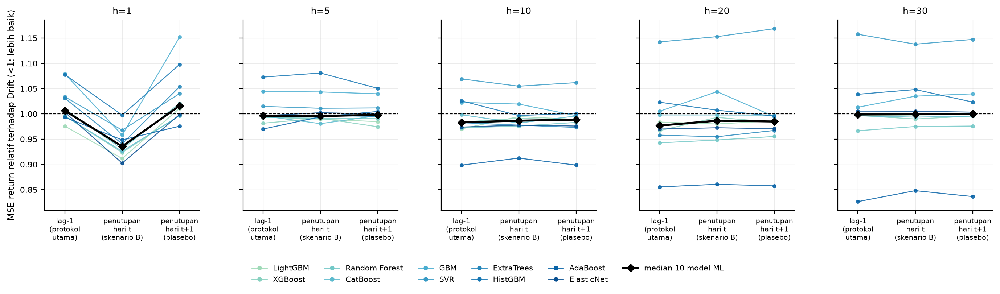

```
outputs/results/tangga_waktu_ringkasan.csv          hari-t / lag1 / plasebo t+1
outputs/results/tangga_waktu_harapan.csv            ekspektasi E1–E3 dan hasilnya
outputs/results/tangga_waktu_shap_porsi.csv
notebooks/19_tangga_waktu_informasi.ipynb
```

---

# Penutup — Kesimpulan, kontribusi, dan batasan

### ❓ Pertanyaan yang dijawab

*Jadi, apa kontribusi proyek ini?*

### 💡 Penjelasan

**Satu paragraf yang bisa dibaca apa adanya:**

> Pada horizon 1 hari, ada pola yang konsisten dari informasi penutupan pasar hari-t
> (eksploratif): perbaikan median ≈ 7,3% terhadap baseline lag-1, lebih baik pada 10 dari
> 10 model dan signifikan pada 9 dari 10 setelah koreksi BH, dan tidak muncul pada kontrol
> plasebo. Pada horizon 5–30 hari, dan untuk tujuh fitur makro lag-1, tidak ada perbedaan
> yang dapat dibuktikan secara statistik terhadap benchmark Drift — dan daya ujinya
> terbatas (MDE terhadap Drift bergulir mencapai 70% pada h=30), sehingga ketiadaan bukti
> di sana tidak boleh dibaca sebagai bukti ketiadaan. Jawaban yang jujur adalah
> "belum terbukti", bukan "tidak ada".

**Tiga kontribusi metodologis** yang tidak bergantung pada hasil:

1. **Tujuh pagar integritas dengan mutation testing.** Bukti numerik bahwa *early
   stopping* tidak bisa melihat data uji (`mae_val` identik digit demi digit saat data
   uji dirusak, sementara `mae_test` berubah 3×). Ini bisa diterapkan ke proyek lain.
2. **Pelaporan MDE bersama hasil negatif.** Tanpa ini, "tidak signifikan" terbaca
   sebagai "tidak ada", padahal dua hal itu berbeda.
3. **Pelaporan berlapis:** klaim statistik utama dilaporkan bersama DM → BH-FDR → MCS →
   selang kepercayaan, dan sensitivitas terhadap pilihan keluarga uji ditampilkan,
   sehingga tidak ada klaim yang berdiri di atas satu uji saja.

**Tujuh batasan yang harus disebut lebih dulu** (jangan menunggu ditanya):

| # | Batasan | Angka pasti |
|---|---|---|
| 1 | **Daya uji terbatas di horizon panjang** | `n_eff` median h=30 = **28,63**; MDE vs Drift tetap h=30 = **5,79%**, tetapi vs Drift bergulir = **70,42%** |
| 2 | **Bukan harga pasar** | harga postingan administratif; **22,47%** hari di periode latih return nol (puncak 2014: 40,6%), ±25% di antaranya hasil *forward-fill* |
| 3 | **Tidak ada XAU/USD** | fitur hanya DXY, S&P 500, USD/IDR, IHSG, US 10Y, FFR, BI-Rate |
| 4 | **Satu aset, satu negara** | kesimpulan berlaku untuk emas Antam (Rp/gram) saja |
| 5 | **Periode uji didominasi satu reli lalu koreksi** | 2023–2026, harga 1,04 → puncak 3,17 juta (2026-01-29) → −17,6% di akhir data; walk-forward: harga naik di 11 dari 12 jendela |
| 6 | **Sumber data emas tidak resmi** | dataset komunitas — perlu validasi silang ke situs resmi |
| 7 | **Temuan Skenario B eksploratif** | dirancang setelah melihat korelasi lead–lag seluruh sampel; kelayakan bergantung pada jam pengumuman Antam yang belum diverifikasi dengan catatan resmi |

**Cara menyajikannya di depan dosen — tiga kalimat yang bisa dipakai:**

1. *"Kami tidak menyembunyikan hasil negatifnya. Dari 210 uji, hanya 1 yang lolos
   koreksi uji berganda — dan hanya pada keluarga uji terkecil; pada keluarga yang lebih
   luas tidak ada. Angka itu harus dibaca apa adanya."*
2. *"Kami juga mengukur daya ujinya: terhadap Drift tetap MDE kami 3–7% di semua horizon,
   tetapi terhadap Drift bergulir di horizon 30 hari MDE-nya 70% — jadi di sana klaim
   'tidak ada efek' pun tidak bisa kami buktikan. Jawabannya adalah 'belum terbukti',
   bukan 'tidak ada'."*
3. *"Ada satu pola yang tidak kami duga: ketika penutupan pasar hari-t dimasukkan, 10 dari
   10 model ML lebih baik di h=1, dan plasebo t+1 tidak menolong. Kami menandainya
   eksploratif, karena skenarionya dirancang setelah melihat korelasi lead–lag dan jam
   pengumuman Antam perlu diverifikasi. Itu ada di Notebook 15 dan 19."*

### 📁 Bukti di repo

```
../CHANGELOG.md            perubahan dan stempel versi
../README.md bagian 9      batasan yang diketahui (termasuk risiko ukuran file .h5)
outputs/results/MANIFEST.json  ringkasan mesin-baca seluruh hasil
```

---

# Lampiran A — Peta file repo

Kalau ditanya *"ini ada di mana?"*, jawabannya:

| Yang ditanya | Lokasi |
|---|---|
| Konfigurasi semua eksperimen | `src/config.py` |
| Logika fitur, split, embargo | `src/pipeline.py` |
| Arsitektur 11 model DL | `src/models_dl.py` |
| **Satu-satunya** jalur pelatihan & penyimpanan hasil | `src/runners.py` |
| 7 pagar integritas | `src/checks.py` → `notebooks/08_*.ipynb` |
| Uji statistik (DM, BH, MCS, PT) | `src/stats.py` → `notebooks/10_*.ipynb` |
| SHAP | `src/explain.py` → `notebooks/11_*.ipynb` |
| Semua figur (69 PNG + 69 PDF) | `outputs/figures/` |
| Semua tabel hasil (48 CSV) | `outputs/results/` |
| 210 run + prediksi + kurva loss | `outputs/results/runs/` |
| Bobot model `.weights.h5` | `outputs/results/models/` |
| Data master | `data/processed/data_gabungan.csv` |
| Notebook urut 00–19 | `notebooks/` |
| Ringkasan angka + grafik (Excel) | `panduan_bimbingan/ringkasan_eksperimen.xlsx` |
| Naskah lisan untuk bimbingan | `panduan_bimbingan/NASKAH_BIMBINGAN.md` |
| Diagram alur penelitian (A/B/C) | `diagram/` |
| Skrip pembantu angka dokumen (bukan eksperimen) | `panduan_bimbingan/skrip/` |

**Alur jalannya satu eksperimen:**
`notebook → src/runners.py → src/pipeline.py (fitur/split, model ML) / src/models_dl.py (model DL) → simpan JSON/CSV`
— notebook tidak pernah menghitung sendiri, sehingga eksperimen utama, ablation, dan
walk-forward tidak mungkin berbeda diam-diam.

---

# Lampiran B — Glosarium

| Istilah | Arti |
|---|---|
| **Direct multi-horizon** | Setiap horizon (1/5/10/20/30) punya model khusus, bukan diramalkan berurutan. Menghindari penumpukan galat. |
| **Embargo** | Baris validasi yang target `i+h`-nya jatuh di periode uji **dibuang** dari *early stopping*. |
| **Drift (benchmark)** | `r̂ = μ_train` — memprediksi return h-hari rata-rata periode latih untuk semua hari uji. Sederhana, tetapi sulit dikalahkan ketika sinyalnya tipis. |
| **Drift ekspansif** | Drift adaptif: rata-rata semua return h-hari yang labelnya sudah diketahui pada origin; diperbarui di setiap origin. |
| **Drift bergulir** | Drift adaptif: rata-rata 250 return h-hari terakhir yang sudah diketahui; diperbarui di setiap origin. Estimasinya berisik, sehingga MDE terhadapnya besar (daya uji rendah). |
| **Diebold–Mariano (DM)** | Uji apakah galat model signifikan lebih kecil daripada pembanding. |
| **HLN** | Koreksi sampel kecil Harvey–Leybourne–Newbold pada statistik DM (dibandingkan dengan distribusi *t*); dipakai bersama penaksir varians jangka panjang untuk galat h-hari yang tumpang-tindih. |
| **BH-FDR** | Koreksi *Benjamini–Hochberg* untuk uji berganda. Tanpa ini, 210 uji pada taraf 5% diharapkan menghasilkan ≈10,5 uji `p < 0,05` hanya karena kebetulan bila tidak ada efek sama sekali. |
| **MCS** | *Model Confidence Set* — set model yang masih layak disebut pemenang. Kalau berisi semua orang → tidak ada pemenang. |
| **MDE** | *Minimum Detectable Effect* — perbedaan terkecil yang masih bisa dideteksi dengan daya uji yang tersedia. |
| **`n_eff`** | Observasi independen efektif; jauh lebih kecil dari jumlah baris karena data saling berkorelasi. |
| **`rel_mse`** | MSE galat return model ÷ MSE pembanding (`rel_mse_ret`; versi ruang harga: `rel_mse_price`). **< 1 = lebih baik.** |
| **Plasebo t+1** | Kontrol: input memakai penutupan pasar hari **t+1**, yang terbit setelah harga target dan mustahil tersedia saat ramalan. Pada h=1 seharusnya tidak menolong — kalau menolong, ada artefak penyelarasan waktu. |
| **Skenario B** | Ramalan malam hari yang memakai penutupan pasar **hari-t** (layak bila harga Antam t+1 diumumkan setelah penutupan pasar AS hari-t — belum diverifikasi). **Eksploratif.** |
| **Stasioneritas / ADF** | Uji apakah deret punya *unit root*. Deret non-stasioner wajib ditransformasi sebelum dipakai. |
| **Mutation testing** | Merusak data uji sengaja, lalu memastikan hasil latih **tidak berubah** — bukti bahwa pelatihan tidak membaca data uji (menutup jalur yang diuji, bukan semua jalur kebocoran). |
| **Overfit / model nol** | Model nol = selalu memprediksi rata-rata target latih. *Skill* diukur relatif terhadapnya. |

---

# Lampiran C — FAQ: kemungkinan pertanyaan dosen

> **Ini bagian yang paling bernilai saat bimbingan.** Baca sekali sebelum pertemuan.

### Q1 — *"Kalau hasilnya hampir semua tidak signifikan, apa kontribusinya?"*

Jawab tiga langkah: (a) kami **tidak menyembunyikannya** — 1 dari 210 lolos BH, dan hanya
pada keluarga uji terkecil; (b) kami **mengukur daya ujinya**, dan MDE h=30 vs Drift
bergulir adalah 70% — jadi "tidak ada efek" pun tidak bisa kami buktikan, jawaban yang
jujur adalah **"belum terbukti"**; (c) ada **satu pola eksploratif yang diuji dengan
plasebo** — informasi hari-t di h=1, 9/10 lolos BH, dan plasebo t+1 tidak menolong;
tandai sebagai eksploratif karena dirancang setelah melihat data.

### Q2 — *"Kenapa XAU/USD (harga emas dunia) tidak dipakai?"*

Kejujuran dulu: **memang tidak dipakai**, dan itu keterbatasan yang kami catat di
README. Tujuh fitur makro hanya DXY, S&P 500, USD/IDR, IHSG, US 10Y, FFR, BI-Rate.
DXY dipakai sebagai *proxy* dolar. Kalau diminta, ini adalah tambahan paling bernilai
untuk iterasi berikutnya.

### Q3 — *"Kenapa hanya DPformer yang dituning? Tidak adil?"*

Pertanyaan bagus, dan **sebagian sudah kami ukur**: ablation MOSSA vs default pada 10 sel
menunjukkan **0/10 lolos BH-FDR** (`q` terendah 0,0713), dan MOSSA lebih baik di 4 dari
10 sel menurut MAE — jadi manfaat tuning **tidak terbukti** (bukan terbukti nol;
`weight_decay` hasil MOSSA ≈ 75–84× default). Ketidaksimetrian ini hanya menguntungkan
DPformer, dan DPformer tetap tidak mengungguli Drift secara konsisten, sehingga kecil
kemungkinannya mengubah kesimpulan utama.

### Q4 — *"Kenapa perlu 21 model? Bukannya cuma bikin ribet?"*

Justru sebaliknya: banyak model dipakai sebagai **uji ketahanan**. Kalau kesimpulan hanya
berlaku untuk satu arsitektur, ia lemah. Kalau kesimpulan yang sama muncul dari 21
arsitektur — termasuk ElasticNet yang sederhana sekaligus Transformer yang kompleks —
ia kuat. Konsekuensinya, karena banyak model diuji, koreksi uji berganda (BH-FDR) menjadi
**keharusan**, bukan pilihan.

### Q5 — *"Kenapa evaluasinya di ruang harga, bukan return?"*

Sebagian. **Metrik titik** (MAE, RMSE, MAPE) dihitung di ruang harga, karena yang
ditanyakan pengguna adalah "berapa rupiah harganya" — satu persen galat di harga 400 ribu
berbeda maknanya dengan 1 persen di harga 3 juta. Tetapi **uji Diebold–Mariano** memakai
galat kuadrat **return** (`rel_mse_ret`): galat di ruang harga sama dengan galat return
dikali harga origin, sehingga hasil di ruang harga memberi bobot lebih besar pada periode
ketika harga tinggi; versi ruang harga (`rel_mse_price`) ada di berkas yang sama sebagai
pembanding. Metrik return tambahan ada di `metrik_return.csv`.

### Q6 — *"Kalau datanya harga administratif, apa gunanya?"*

Ini justru yang membuat menarik: **22,47% hari di periode latih tidak bergerak** (±75%
di antaranya hari dengan pengumuman berharga sama, ±25% hari tanpa pengumuman yang diisi
*forward-fill*), jadi model harus belajar **kapan harga bergerak**, bukan hanya seberapa
jauh — dan itu berbeda dari deret harga pasar biasa. Kami laporkan ini sebagai temuan,
bukan menyembunyikannya.

### Q7 — *"Apa itu embargo, dan kenapa repot-repot?"*

Lihat Notebook 04. Ringkasnya: baris validasi terakhir punya target `i+h` yang jatuh di
periode uji. Kalau tetap dipakai untuk *early stopping*, saat memilih model terbaik kita
sudah membaca harga uji. Pada h=30, 30 dari 429 baris dibuang. Tanpa ini, hasilnya akan
**terlalu bagus dan tidak ada yang menyadarinya**.

### Q8 — *"Kenapa multivariat tidak lebih baik dari univariat?"*

Dari 105 uji, 40 punya rasio < 1 (median 1,003) dan 5 mencapai `p < 0,05`, tetapi **0 lolos
BH-FDR** (keluarga = seluruh 105 uji; dengan keluarga per horizon, 2 lolos — GBM dan HistGBM
di h=1).
Yang paling mendekati adalah GBM (0,915) dan HistGBM (0,910) di h=1 — `q` = 0,069, tidak
lolos. Jadi yang bisa kami katakan adalah "tidak terbukti", bukan "tidak membantu". SHAP
(h=20, tiga model wakil) hanya memberi gambaran ketergantungan: model DL memberi bobot
52–58% pada kelompok makro global (DXY, S&P 500, US 10Y, FFR), sedangkan AdaBoost — peringkat
rata-rata terbaik — **75,8%-nya dari harga emas sendiri**. Dugaan bahwa informasi makro sudah
terwakili oleh return emas sendiri (termasuk lewat DXY) **belum kami uji**; SHAP tidak
membuktikannya.

### Q9 — *"Ini kan pakai AI, sepenuhnya otomatis?"*

Jawab dua bagian, dan **isi bagian pertama sesuai kenyataan dan aturan kampus/jurnal**.

**(1) Peran AI — diisi penulis.** Susunan yang jujur (ganti isian `[ISI: …]`):
*"Saya memakai [ISI: nama alat AI] untuk [ISI: bagian pekerjaan — mis. membantu menulis
kode, menyusun draf dokumentasi, memeriksa angka]. Keputusan desain eksperimen (target,
split, embargo, benchmark, pilihan model) [ISI: siapa yang memutuskan dan bagaimana kamu
memeriksanya]. Hasil saya jalankan dan periksa sendiri dengan [ISI: cara — mis. menjalankan
ulang notebook, mencocokkan angka dengan CSV]. Penggunaan ini [ISI: dilaporkan di bagian …
/ sesuai kebijakan …]."* Jangan menyatakan hal yang tidak benar tentang siapa yang
mengerjakan apa.

**(2) "Sepenuhnya otomatis?" — tidak, dan ini yang bisa ditunjukkan.** Seluruh
pelatihan/analisis lewat `src/runners.py`, **satu jalur** untuk eksperimen utama,
ablation, walk-forward, dan uji seed — notebook tidak menghitung sendiri, jadi hasil tidak
bisa berbeda diam-diam antar-notebook. Ditambah 7 pagar integritas di Notebook 08, termasuk
*mutation testing* yang bisa ditunjukkan angkanya. Otomatisasi ini mengurangi galat teknis,
tetapi **tidak menggantikan** keputusan penelitian dan pemeriksaan hasil oleh penulis.

### Q10 — *"Bisa dipakai untuk trading?"*

Belum, dan itu kesimpulan penelitian ini sendiri: pada h=5–30 tidak ada model yang
signifikan mengalahkan Drift (setelah koreksi BH), dan di MCS **Drift masuk di seluruh 10
kombinasi**; di h=1 pun hanya satu uji yang lolos pada keluarga terkecil, dengan efek ≈0,5%.
Pola yang paling layak diuji lanjut adalah **h=1 dengan informasi penutupan hari-t** —
tetapi itu eksploratif, jam pengumuman Antam harus diverifikasi, dan biaya transaksi serta
selisih harga jual–beli kembali (*buyback*) belum dimasukkan. Ini bukan rekomendasi trading.

### Q11 — *"Kenapa walk-forward hanya diuji h=5 dan h=20?"*

6 fold × 260 hari memakai sekitar enam tahun data terakhir (origin ≈ 2020-07/08 s.d.
2026-07). h=5 dan h=20 dipilih sebagai perwakilan horizon pendek dan panjang, dengan alasan
[ISI: alasan yang benar-benar kamu pakai — mis. biaya komputasi]. Ini keterbatasan yang
kami catat, bukan keputusan yang disembunyikan.

### Q12 — *"Apa bedanya Drift biasa dan Drift bergulir?"*

Drift biasa (benchmark utama) = rata-rata return h-hari **seluruh** periode latih, tetap
untuk seluruh periode uji. Drift ekspansif = rata-rata semua return h-hari yang sudah
diketahui pada origin (bertambah seiring waktu). Drift bergulir = rata-rata **250** return
h-hari terakhir yang sudah diketahui, diperbarui di setiap origin, sehingga **adaptif**.
MDE terhadap Drift bergulir jauh lebih besar (48% di h=20, 70% di h=30) karena estimasinya
sendiri berisik — artinya **daya uji lebih rendah**, bukan bahwa ia "lebih sulit
dikalahkan". Sebaliknya, banyak model yang tampak lebih baik dari Drift tetap **tidak**
lebih baik dari Drift adaptif: pada h=10, `rel_mse < 1` pada 32 dari 42 kombinasi vs Drift
tetap, 19/42 vs ekspansif, 3/42 vs bergulir — sebagian keunggulan atas Drift tetap
kemungkinan pergeseran level (Notebook 09 butir 3; Notebook 17–18).

### Q13 — *"Kenapa semua model DL pakai AdamW lr=1e-3?"*

Keseragaman supaya perbandingan adil dan hasilnya bisa direproduksi: sepuluh baseline DL
memakai AdamW dengan `lr` 1e-3 dan `weight_decay` 1e-4, tanpa grid atau tuning, mengikuti
Bao et al. (2026), *Table 3* (patokan eksternal yang bisa diperiksa). Hanya DPformer yang
dituning (MOSSA, Notebook 05) — dan manfaat tuning itu tidak terbukti (0/10 lolos BH).

### Q14 — *"Bagaimana kalau mau menambah variabel / mengulang?"*

Jalannya di Lampiran D. Yang harus dijaga: tiga stempel di setiap run JSON —

```
protocol  = v9-21model-dpformer-bao-aligned-honest-mossa-shap-leakage-safe-embargo
rev       = ml-r2
data_hash = 7aea8db80d44
```

Kalau salah satunya berubah, run dianggap **basi** dan otomatis dihitung ulang — jadi
tidak mungkin mencampur hasil lama dengan data baru.

---

# Lampiran D — Cara menjalankan ulang

Detail teknis lengkap ada di [`../README.md`](../README.md) §6. Ringkasnya:

```powershell
# 1. environment
python -m venv .venv
.\.venv\Scripts\activate
python -m pip install -r requirements.txt        # 17 paket langsung terkunci

# 2. jalankan notebook berurutan 00 → 19
jupyter notebook
```

```powershell
# 3. mode cepat (smoke test, beberapa menit)
$env:TA_QUICK = "1"      # horizon [5,20], 2 epoch, output ke outputs_quick/

# 4. variabel lain
$env:TA_LANG = "id"      # bahasa label figur: id | en
$env:TA_THREADS = "2"    # batas thread CPU (default 2); atur sebelum kernel notebook dimulai
```

Seed acak **tidak** diatur lewat variabel lingkungan: `SEED = 42` ada di `src/pipeline.py`
dan seed tambahan (43–46) di `SEEDS_EXTRA` pada `src/config.py`.

Sebagian besar notebook **tidak mengulang pekerjaan yang sudah ada** — `src/runners.py`
memeriksa `protocol`, `rev`, dan `data_hash` pada tiap run, dan hanya run basi yang
dihitung ulang.

**Stempel saat freeze `v1.0.0`:** 210/210 run CURRENT, 0 basi · 20/20 notebook
tereksekusi, 0 error output · 69 PNG + 69 PDF.

---

# Lampiran E — Peta bab lama → bagian baru

Versi sebelumnya disusun per topik (Bab 01–12). Dokumen lain (mis. `NASKAH_BIMBINGAN.md`) mungkin masih merujuk nomor bab lama; tabel ini menerjemahkannya.

| Bab lama | Isi | Sekarang di |
|---|---|---|
| 01 | Latar belakang dan pertanyaan penelitian | Pembuka |
| 02 | Data dan sumber | Notebook 00 (sumber), 02 (tabel master, lag-1), 03 (level vs stasioner) |
| 03 | Pembersihan dan penggabungan | Notebook 01 (pembersihan, *forward-fill*), 02 (FFR *as-of*) |
| 04 | EDA dan stasioneritas | Notebook 03 (ADF, return nol, lead–lag), 04 (rezim pasar) |
| 05 | Desain eksperimen | Notebook 04 |
| 06 | Model yang dipakai | Notebook 05 (21 model, DPformer, MOSSA), 06 (baseline DL), 14 (keadilan tuning) |
| 07 | Tujuh pagar integritas | Notebook 08 |
| 08 | Hasil dasar dan peringkat | Notebook 07 (Drift), 09 (hasil, peringkat), 17–18 (pergeseran level) |
| 09 | Uji statistik | Notebook 10 (DM, BH, MCS), 17 (selang kepercayaan, MDE), Penutup (tiga kalimat penyajian) |
| 10 | Interpretasi (SHAP) | Notebook 11 |
| 11 | Ketahanan | Notebook 13 (seed), 14 (ablasi), 16 (walk-forward), 15 dan 19 (Skenario B, plasebo) |
| 12 | Kesimpulan, kontribusi, batasan | Penutup |

---

<sub>Catatan belajar · `panduan_bimbingan/` · Dokumen v1.0.2 (hasil dibekukan pada v1.0.0) · Protokol `v9` · data_hash `7aea8db80d44` · 2026-10-31</sub>
