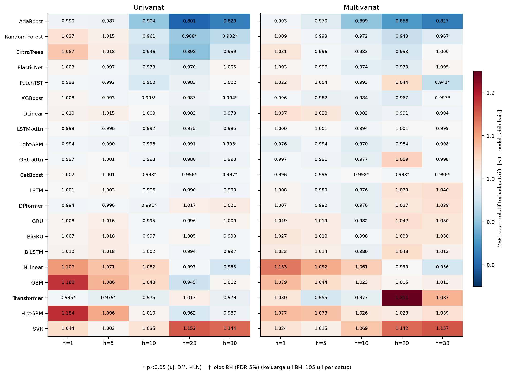
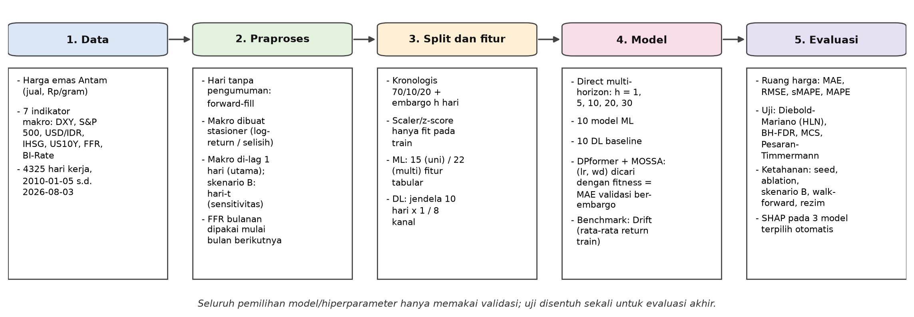

# RINGKASAN — Peramalan Harga Emas Antam

> Satu halaman. Untuk membuka bimbingan, atau kalau hanya ada 5 menit.
> Penjelasan penuh: [`PENJELASAN.md`](PENJELASAN.md)

**Versi** 1.0.0 · **Protokol** `v9-21model-dpformer-bao-aligned-honest-mossa-shap-leakage-safe-embargo` · **Sidik jari data** `7aea8db80d44`

---

## Masalah

Harga jual emas Antam (Rp/gram) dikelola sebagai **harga postingan administratif**, bukan
harga pasar yang bergerak terus-menerus: pada hari tanpa pengumuman harga, harganya
**tetap**. Dari 4.325 hari kerja (2010-01-05 s.d. 2026-08-03), **22,47% hari pada periode
latih punya return tepat nol**. Pertanyaannya: apakah dengan 7 variabel makro (DXY,
S&P 500, USD/IDR, IHSG, US 10Y, FFR, BI-Rate) kita bisa memprediksi harga emas tersebut
1, 5, 10, 20, atau 30 hari ke depan — dan seberapa yakin kita bisa mengklaim demikian?

## Metode

**21 model** (10 machine learning + 11 deep learning) × **2 setup fitur** (univariat /
multivariat) × **5 horizon** = **210 eksperimen**, semuanya dibandingkan terhadap
benchmark **Drift** (return rata-rata periode latih) dengan pembagian data kronologis
70/10/20 yang ber-**embargo**. Kejujuran metode dites melalui **7 pagar integritas**,
termasuk *mutation testing* — merusak data uji secara sengaja lalu memastikan hasil
latih tidak berubah.

---

## Lima temuan

**1. Satu-satunya model yang mengalahkan Drift secara signifikan secara statistik hanyalah satu.**

Dari **210** uji *Diebold–Mariano*, 115 menghasilkan `rel_mse < 1`, 16 mencapai
`p < 0,05`, tetapi **hanya 1 yang lolos koreksi Benjamini–Hochberg**:
*univariat transformer, h=1*, `rel_mse` **0,9950** (`q` = 0,041).

**2. Variabel makro global tidak menambah informasi.**

Dari **105** uji multivariat vs univariat pada seluruh horizon: 40 punya rasio < 1 dan
5 mencapai `p < 0,05`, tetapi **0 lolos BH-FDR** (keluarga = seluruh 105 uji). Yang paling
mendekati adalah GBM (0,915) dan HistGBM (0,910) di h=1 — `q` = 0,069, tetap tidak lolos.
Faktor S&P 500/US 10Y memang mengangkat horizon pendek, tetapi efeknya tenggelam
oleh koreksi.

**3. Yang benar-benar membantu adalah informasi penutupan pasar hari-t.**

Skenario B (memakai penutupan hari-t) pada h=1: median `rel_mse` **0,9266** dan
**9 dari 10** model lolos BH-FDR — perbaikan **7,3%**. Pada varian yang lebih luas
(12 model) angkanya **11 dari 12** lolos dengan median **0,9267**. Sebagai kontrol,
**plasebo t+1** (tanggal diputar mundur) menghasilkan median 1,0086 dan **0 lolos BH**.
Dengan begitu temuannya bukan artefak.

**4. Variasi seed jauh lebih kecil daripada selisih antar-model.**

60 kombinasi (6 model DL × 2 setup × 5 horizon, 5 seed) memberikan **CV MAE
0,034%–1,30%** (median 0,29%). Selisih antar-model ratusan kali lebih besar —
peringkatnya stabil.

**5. Return emas hampir efisien, dan itu temuan, bukan kegagalan.**

MCS 90% memasukkan **209 dari 220** sel, dan **Drift masuk *confidence set* di seluruh
10 sel** (2 setup × 5 horizon). Walk-forward 6 fold (2020–2026) juga **0 model lolos
BH**. Absennya perbedaan pada horizon panjang **bukan** bukti ketiadaan efek: daya
ujinya memang tidak cukup.

---

## Kesimpulan

Ketidakmampuan 20 model lain mengalahkan Drift **sama nilainya** dengan keberhasilan
satu model — keduanya menunjukkan hal yang sama: pada horizon 1 hari, sinyal terkecil
dari penutupan pasar hari-t **nyata dan dapat dibuktikan**; pada horizon ≥ 5 hari dan
pada fitur makro global, sinyalnya tidak dapat dibedakan dari nol. **Jawaban yang jujur
adalah "belum terbukti", bukan "tidak ada".**

---

## Tiga batasan yang harus disebut lebih dulu

| # | Batasan |
|---|---|
| 1 | **Daya uji terbatas.** Median observasi independen di h=30 hanya **28,63**; MDE terhadap Drift bergulir mencapai **48–70%**. Hasil negatif di horizon panjang = tidak cukup daya, bukan bukti nol. |
| 2 | **Bukan harga pasar.** Ini harga postingan administratif Antam — 22,47% hari di periode latih tidak bergerak. |
| 3 | **Tidak ada XAU/USD.** Tujuh fitur makro adalah DXY, S&P 500, USD/IDR, IHSG, US 10Y, FFR, BI-Rate. Emas dunia tidak ikut serta. |

---

## Dua gambar yang paling mungkin ditanya

*Semua titik di kiri garis 1,0 berarti model lebih baik dari Drift — tetapi hanya satu
yang bertahan setelah koreksi uji berganda (BH-FDR). → pembahasan lengkap di `PENJELASAN.md` bab 09.*

*Alur keseluruhan dari data mentah sampai kesimpulan. → `PENJELASAN.md` pembuka.*

---

Baca lanjutan: [`PENJELASAN.md`](PENJELASAN.md) — penjelasan urut dari awal sampai akhir, per bab, dengan tautan ke file bukti.
